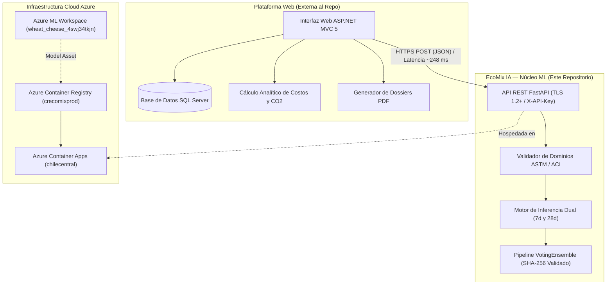

# 🌱 EcoMix IA — Núcleo de Machine Learning y Servicio de Inferencia en Azure

[](https://github.com/JMedina255/EcoMix-IA-AzureML/actions/workflows/validate.yml)
[](https://www.python.org/)
[](https://azure.microsoft.com/services/machine-learning/)
[](https://azure.microsoft.com/products/container-apps)
[](LICENSE)

Sistema de Machine Learning y microservicio cloud para la predicción de resistencia a la compresión ($f'_c$ en MPa) a **7 y 28 días** en mezclas de concreto convencionales y ecológicas, optimizando la incorporación de materiales cementantes suplementarios (escoria de alto horno y cenizas volantes).

Desarrollado en el marco del **Reto 2 de Yura S.A.** (Hackathon Innova Sur 2026, Universidad Privada de Tacna).

---

## 📌 1. Visión y Alcance del Repositorio

### 1.1 Delimitación de Responsabilidades
Este repositorio (`JMedina255/EcoMix-IA-AzureML`) contiene **exclusivamente el núcleo de Machine Learning, el pipeline de datos, la gobernanza de experimentos en Azure ML y el microservicio de inferencia en Azure Container Apps**.



> [!IMPORTANT]
> **Aclaración sobre optimización:** El modelo de Machine Learning es estrictamente un **predictor de resistencia mecánica** ($f'_c$ en MPa). La optimización multicriterio de costo ($\text{S/./m}^3$) y huella de carbono ($\text{kg CO}_2\text{e/m}^3$) corresponde a fórmulas analíticas calculadas en la capa de negocio de la plataforma ASP.NET MVC 5, no a un regresor que minimice dichas variables directamente.

---

## 🏗️ 2. Dataset y Variables Predictoras (UCI ID 165)

El modelado se sustenta en el estándar internacional de dosificación [UCI Machine Learning Repository ID: 165 (*Concrete Compressive Strength*)](https://archive.ics.uci.edu/dataset/165/concrete+compressive+strength), con 1,030 probetas experimentales y partición determinística 80/20 (824 train, 206 test, semilla `42`, SHA-256 canónico del test set: `6484d9f1...`).

| Variable Técnica | Identificador | Rol | Unidad | Rango en Dataset | Descripción |
| :--- | :--- | :---: | :---: | :---: | :--- |
| **Cement** | `cement` | Entrada | $\text{kg/m}^3$ | 102.0 – 540.0 | Cemento Portland tipo I/IP |
| **Blast Furnace Slag** | `blast_furnace_slag` | Entrada | $\text{kg/m}^3$ | 0.0 – 359.4 | Escoria granulada de alto horno (SCM) |
| **Fly Ash** | `fly_ash` | Entrada | $\text{kg/m}^3$ | 0.0 – 200.1 | Ceniza volante puzolánica (SCM) |
| **Water** | `water` | Entrada | $\text{kg/m}^3$ | 121.8 – 247.0 | Agua efectiva de mezclado |
| **Superplasticizer** | `superplasticizer` | Entrada | $\text{kg/m}^3$ | 0.0 – 32.2 | Aditivo reductor de agua de alto rango |
| **Coarse Aggregate** | `coarse_aggregate` | Entrada | $\text{kg/m}^3$ | 801.0 – 1145.0 | Agregado grueso (grava triturada) |
| **Fine Aggregate** | `fine_aggregate` | Entrada | $\text{kg/m}^3$ | 594.0 – 992.6 | Agregado fino (arena natural) |
| **Age** | `age` | Entrada | días | 1 – 365 | Período de curado estándar (ASTM C39) |
| **Compressive Strength** | `concrete_compressive_strength` | **Objetivo** | $\text{MPa}$ | 2.3 – 82.6 | Resistencia a compresión uniaxial |

---

## 🔬 3. Entrenamiento AutoML y Evaluación Verificada

### 3.1 Experimento AutoML en Azure ML
* **Identificador del Job:** `wheat_cheese_4swj34tkjn`
* **Clúster de Cómputo:** `cpu-cluster-ecomix` (`Standard_DS3_v2`, 4 vCPUs, 14 GiB RAM)
* **Algoritmo Ganador:** `VotingEnsemble` (Child Run: `wheat_cheese_4swj34tkjn_11`)
* **Métrica Primaria de Entrenamiento:** $\text{NRMSE} = \mathbf{0.05859}$ (Validación cruzada $k=5$)
* **Activo de Modelo (Model Asset):** `azureml_wheat_cheese_4swj34tkjn_11_output_mlflow_log_model_873731674:1` (670,849 bytes)

### 3.2 Evaluación Independiente en la Nube (Fase 4.4)
Evaluación ciega sobre el conjunto de prueba independiente de **206 observaciones** (`concrete_test.csv`) ejecutada en contenedor curado en Azure ML (Job `stoic_pot_x25ht98nv7`):

| Métrica | Nube / Prueba Independiente | Validación Interna AutoML | Interpretación Técnica |
| :--- | :---: | :---: | :--- |
| **Coeficiente de Determinación ($R^2$)** | **0.9121** | — | El modelo explica el 91.21% de la varianza en datos no vistos |
| **RMSE (Error Cuadrático Medio)** | **4.7592 MPa** | — | Desviación típica del error de predicción |
| **MAE (Error Absoluto Medio)** | **3.2822 MPa** | — | Error promedio esperado por probeta |
| **NRMSE (Normalizado)** | **0.0673** | **0.05859** | Discrepancia esperada entre CV interna y prueba ciega independiente |
| **Subconjunto sin solapamiento (195 filas)** | **$R^2 = 0.9174$, $\text{RMSE} = 4.587\text{ MPa}$** | — | Confirma ausencia de sobreajuste por réplicas experimentales |
| **Desglose a 7 días (41 probetas)** | **$R^2 = 0.8841$, $\text{RMSE} = 5.1725\text{ MPa}$** | — | Excelente captura de resistencia temprana |
| **Desglose a 28 días (87 probetas)** | **$R^2 = 0.8235$, $\text{RMSE} = 5.5930\text{ MPa}$** | — | Resistencia de diseño conforme a ACI PRC-211.1-22 |

---

## ⚡ 4. Mecanismo de Inferencia Dual (7d y 28d)

La variable `age` entra como atributo al modelo. Para proporcionar la información crítica que requiere un ingeniero de obra sin obligarlo a realizar dos llamadas separadas, el microservicio evalúa la misma dosificación fijando internamente `age = 7` y `age = 28`.

### 4.1 Caso Real Verificado
Dosificación canónica sin aditivos (`280 / 0 / 0 / 180 / 0 / 1050 / 750`):
* `cement`: $280.0\text{ kg/m}^3$
* `blast_furnace_slag`: $0.0\text{ kg/m}^3$
* `fly_ash`: $0.0\text{ kg/m}^3$
* `water`: $180.0\text{ kg/m}^3$
* `superplasticizer`: $0.0\text{ kg/m}^3$
* `coarse_aggregate`: $1050.0\text{ kg/m}^3$
* `fine_aggregate`: $750.0\text{ kg/m}^3$

**Resultados numéricos certificados:**
* Resistencia a 7 días: **`21.96 MPa`**
* Resistencia a 28 días: **`31.15 MPa`**
* Relación agua/cemento ($w/c$): **`0.643`**
* Densidad teórica de mezcla: **`2,260.0 kg/m³`**
* Estado del modelo: **`is_synthetic: false`** (estimador real `VotingEnsemble`)

---

## 💻 5. Entorno de Desarrollo vs Runtime de Producción

| Dimensión | Entorno de Desarrollo / CI | Runtime de Producción (Contenedor) |
| :--- | :--- | :--- |
| **Python** | 3.10 a 3.13.x | **Python 3.10.19** exacto |
| **Imagen Base** | Host local / Ubuntu en GitHub Actions | `mcr.microsoft.com/azureml/curated/ai-ml-automl:41` |
| **Scikit-Learn** | $\ge 1.4.0$ (compatible para testing) | **1.5.1** (idéntica a la serialización del modelo) |
| **MLflow** | $\ge 2.15.0$ | **2.15.1** |
| **Framework Web** | FastAPI $\ge 0.115.6$, Starlette $\ge 0.41.3$, httpx $== 0.28.1$ | FastAPI 0.115.6, Starlette 0.41.3, Uvicorn 0.34.0 |
| **Aislamiento** | Importaciones diferidas del SDK (`TYPE_CHECKING`) | Zero-Azure-SDK en runtime de inferencia |

---

## ☁️ 6. Despliegue en la Nube (ACR y Azure Container Apps)

El microservicio se encuentra desplegado y validado operativamente en **Azure Container Apps** en la región `chilecentral`:

* **Servicio:** Azure Container Apps (ACA) — Perfil *Serverless Consumption*
* **Nombre de la Aplicación:** `ca-ecomix-inference-api`
* **Entorno:** `env-ecomix-prod` en `chilecentral`
* **Registro de Contenedores:** `crecomixprod.azurecr.io` (SKU Basic, sin cuenta admin)
* **Imagen Certificada:** `crecomixprod.azurecr.io/ecomix-ml-inference:1.0.0`
* **Digest OCI:** `sha256:f50d37251430ad1e42d8df663554e0ea346a8dfffae8799393023d4afbb1d12a`
* **Autenticación ACR:** Managed Identity asignada por usuario (`id-ecomix-aca`) con rol `AcrPull`
* **Recursos:** 1.0 vCPU, 2.0 GiB RAM por réplica
* **Política de Autoescala:** `minReplicas = 0`, `maxReplicas = 1` (*Scale-to-Zero* habilitado)
* **Comportamiento Operativo:**
  * **Cold Start (Arranque en frío):** ~8.4 segundos (tiempo de provisión de réplica y carga en memoria del `VotingEnsemble` de 670 KB).
  * **Latencia en Caliente (Warm):** **~248 ms** (promedio en 3 llamadas consecutivas HTTPS).
  * **Costo Acumulado:** USD 0.00 (amparado en la cuota mensual gratuita de ACA).

---

## 🔒 7. Endpoints de la API y Seguridad DevSecOps

El servicio implementa autenticación mediante cabecera `X-API-Key`, mitigación de timing attacks con `secrets.compare_digest`, sanitización de `X-Request-ID` y respuestas de error estandarizadas bajo **RFC 7807** (`application/problem+json`).

### 7.1 `GET /health/live`
Sonda de vida para orquestadores Kubernetes / ACA.
* **Respuesta:** HTTP 200 `{"status": "alive"}`

### 7.2 `GET /health/ready`
Sonda de preparación que verifica que el modelo real esté cargado y su hash SHA-256 coincida con el activo auditado.
* **Respuesta (Extracto real certificado):**
  ```json
  {
    "status": "ready",
    "model_loaded": true,
    "is_synthetic": false,
    "model_sha256": "7eaa501c5eeb60135effb6b5861e736518ce969c47afd53727c2451083ff6388",
    "algorithm": "RegressionPipeline"
  }
  ```

### 7.3 `POST /api/v1/predict/concrete-strength`
Endpoint predictivo dual protegido con `X-API-Key`.
* **Headers requeridos:**
  * `Content-Type: application/json`
  * `X-API-Key: <api_key_segura>`
* **Cuerpo de Solicitud:**
  ```json
  {
    "cement": 280.0,
    "blast_furnace_slag": 0.0,
    "fly_ash": 0.0,
    "water": 180.0,
    "superplasticizer": 0.0,
    "coarse_aggregate": 1050.0,
    "fine_aggregate": 750.0
  }
  ```
* **Respuesta Exitosa (HTTP 200):**
  ```json
  {
    "success": true,
    "prediction_7d_mpa": 21.96,
    "prediction_28d_mpa": 31.15,
    "water_cement_ratio": 0.643,
    "total_binder_kg_m3": 280.0,
    "effective_replacement_ratio": 0.0,
    "warnings": []
  }
  ```

---

## 🛠️ 8. Guía de Reproducción Local y Testing

### 8.1 Instalación en Entorno Local
```bash
# 1. Clonar el repositorio
git clone https://github.com/JMedina255/EcoMix-IA-AzureML.git
cd EcoMix-IA-AzureML

# 2. Crear y activar entorno virtual
python -m venv .venv
.venv\Scripts\Activate.ps1    # En Windows PowerShell
# source .venv/bin/activate   # En Linux / macOS

# 3. Instalar dependencias de desarrollo y testing
pip install --upgrade pip
pip install -r requirements.txt
pip install -r requirements-dev.txt
```

### 8.2 Diagnóstico de Integridad (`doctor.py`)
Ejecuta una inspección completa de librerías, repositorios, credenciales y datasets:
```bash
python scripts/doctor.py
```

### 8.3 Ejecución de Pruebas Automatizadas
La suite contiene **177 pruebas automatizadas** que cubren contratos, endurecimiento DevSecOps, consistencia de schemas y paridad matemática:
```bash
python -m pytest tests/ -v
```

### 8.4 Verificación de Sincronización de Estado
```bash
python scripts/sync_state.py --check
```

---

## 📚 9. Estructura y Navegación Documental

| Documento | Ubicación | Propósito |
| :--- | :--- | :--- |
| **Índice General de Documentación** | [`docs/INDEX.md`](docs/INDEX.md) | Directorio integral con mapa de reportes y estado de fases |
| **Estado Vivo del Proyecto** | [`docs/PROJECT_STATE.md`](docs/PROJECT_STATE.md) | Trazabilidad declarativa sincronizada con `config/project_status.json` |
| **Informe de Visión (v1.0)** | [`docs/FD02-EPIS-Informe_Vision_EcoMixIA.md`](docs/FD02-EPIS-Informe_Vision_EcoMixIA.md) | Marco conceptual del Reto 2 Yura S.A. y análisis de sostenibilidad |
| **Especificación de Requerimientos (SRS)** | [`docs/FD03-EPIS-Informe_SRS_EcoMixIA_v0.1.md`](docs/FD03-EPIS-Informe_SRS_EcoMixIA_v0.1.md) | Requerimientos funcionales, RN-01 a RN-12 e ISO/IEC 25010 |
| **Reporte de Evaluación Oficial** | [`docs/EVALUATION_REPORT.md`](docs/EVALUATION_REPORT.md) | Métricas técnicas, matrices de correlación y análisis de dispersión |
| **Plan de Integración ASP.NET MVC 5** | [`docs/PHASE_6_1_MVC_INTEGRATION_PLAN.md`](docs/PHASE_6_1_MVC_INTEGRATION_PLAN.md) | Arquitectura, contratos DTO y guía de implementación para el cliente web |
| **Despliegue Azure Container Apps** | [`docs/PHASE_5_6_C_3_ACA_DEPLOYMENT_REPORT.md`](docs/PHASE_5_6_C_3_ACA_DEPLOYMENT_REPORT.md) | Certificación de infraestructura, logs de arranque y validación cloud |
| **Runbook Operativo de Inferencia** | [`docs/INFERENCE_OPERATIONAL_RUNBOOK.md`](docs/INFERENCE_OPERATIONAL_RUNBOOK.md) | Guía de mantenimiento, rotación de claves, monitoreo y solución de problemas |

---

## 🎯 10. Próximos Hitos

1. **Fase 6.1 — Integración con ASP.NET MVC 5:** Consumo del endpoint en Azure Container Apps desde la capa de servicios de la plataforma web.
2. **Implementación de Optimización en Capa de Negocio:** Integración de los algoritmos analíticos para cálculo de costo ($\text{S/./m}^3$) y reducción de huella de carbono ($\text{kg CO}_2\text{e/m}^3$) vinculados al predictor $f'_c$.
3. **Fase 7 — Simulador Interactivo (Streamlit UI):** Prototipo de laboratorio para curvas de curado y sensibilidad multivariable.
