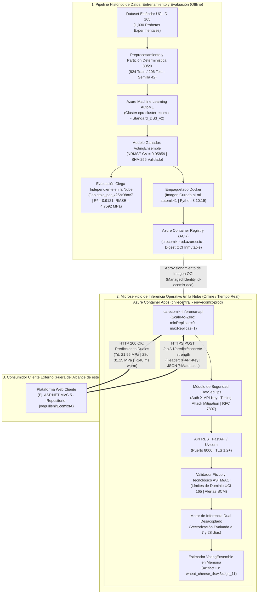

# 🌱 EcoMix IA — Núcleo de Machine Learning y Microservicio de Inferencia en Azure

[](https://github.com/JMedina255/EcoMix-IA-AzureML/actions/workflows/validate.yml)
[](https://www.python.org/)
[](https://azure.microsoft.com/services/machine-learning/)
[](https://azure.microsoft.com/products/container-apps)
[](https://github.com/JMedina255/EcoMix-IA-AzureML/actions/runs/42527034654)

Repositorio oficial del núcleo de Machine Learning, gobernanza de experimentos en Microsoft Azure y microservicio REST de inferencia de alta disponibilidad para la plataforma **EcoMix IA**.

Desarrollado en el marco del **Reto 2 de Yura S.A.** (Hackathon Innova Sur 2026, Universidad Privada de Tacna).

---

## 📋 Tabla de Contenidos
1. [Presentación de EcoMix IA y Finalidad del Repositorio](#-1-presentación-de-ecomix-ia-y-finalidad-del-repositorio)
2. [Problemática y Objetivo Predictivo](#-2-problemática-y-objetivo-predictivo)
3. [Arquitectura Técnica del Modelo y Servicios Azure](#-3-arquitectura-técnica-del-modelo-y-servicios-azure)
4. [Dataset UCI 165, Variables y Preparación](#-4-dataset-uci-165-variables-y-preparación)
5. [Proceso de Entrenamiento Azure AutoML](#-5-proceso-de-entrenamiento-azure-automl)
6. [Selección del Modelo VotingEnsemble](#-6-selección-del-modelo-votingensemble)
7. [Evaluación Independiente y Métricas](#-7-evaluación-independiente-y-métricas)
8. [Implementación del Motor de Inferencia](#-8-implementación-del-motor-de-inferencia)
9. [API REST FastAPI y Despliegue Azure](#-9-api-rest-fastapi-y-despliegue-azure)
10. [Ejemplo Real de Inferencia a 7 y 28 Días](#-10-ejemplo-real-de-inferencia-a-7-y-28-días)
11. [Instrucciones para Ejecutar y Verificar Localmente](#-11-instrucciones-para-ejecutar-y-verificar-localmente)
12. [Pruebas Automatizadas, Seguridad y CI](#-12-pruebas-automatizadas-seguridad-y-ci)
13. [Índice Documental y Conclusiones](#-13-índice-documental-y-conclusiones)

---

## 📌 1. Presentación de EcoMix IA y Finalidad del Repositorio

**EcoMix IA** es una iniciativa de base tecnológica orientada a impulsar la descarbonización y sostenibilidad en la industria de la construcción mediante el diseño inteligente de mezclas de concreto con materiales cementantes suplementarios (SCM), tales como escoria granulada de alto horno (*blast furnace slag*) y cenizas volantes puzolánicas (*fly ash*).

Este repositorio (`JMedina255/EcoMix-IA-AzureML`) contiene **exclusivamente la ingeniería de datos, el modelado predictivo de Machine Learning y el microservicio cloud de inferencia**. Constituye una referencia técnica independiente, auditable y autocontenida que encapsula el ciclo de vida MLOps: desde la adquisición de datos normalizados hasta el servicio de predicción en producción en Azure Container Apps.

> [!IMPORTANT]
> **Delimitación de Responsabilidades:**
> La interfaz gráfica web institucional (ASP.NET MVC 5), la persistencia relacional transaccional (SQL Server), el control de acceso de usuarios y la generación de expedientes PDF residen en la plataforma cliente externa ([`joeguillenl/EcomixIA`](https://github.com/joeguillenl/EcomixIA)). Este repositorio no implementa capas frontend ni almacenamiento relacional.

---

## 🎯 2. Problemática y Objetivo Predictivo

En la práctica de la ingeniería civil bajo normas técnicas peruanas (NTP) y el código **ACI PRC-211.1-22**, la resistencia a la compresión ($f'_c$ en MPa) es el parámetro estructural gobernante. Tradicionalmente, la verificación de mezclas requiere ensayos destructivos de rotura de probetas cilíndricas (ASTM C39) a los 7 y 28 días de curado húmedo, introduciendo ventanas de espera que ralentizan la toma de decisiones en obra.

### 2.1 Objetivo Técnico del Modelo
Entrenar y servir un modelo de aprendizaje automático de alta precisión capaz de predecir la resistencia a la compresión $f'_c$ a **7 y 28 días** para una formulación de 7 materiales, permitiendo evaluar anticipadamente el comportamiento mecánico de dosificaciones ecológicas con sustitución parcial de clínker.

### 2.2 Advertencia de Alcance y Responsabilidad Estructural
* **Predictor Mecánico Puro:** El modelo predice estrictamente la resistencia a la compresión ($f'_c$ en MPa).
* **Optimización de Costos y Huella de Carbono:** La optimización multiobjetivo de costos ($\text{S/./m}^3$) y balance de emisiones ($\text{kg CO}_2\text{e/m}^3$) corresponde a **fórmulas analíticas calculadas en la capa de negocio de la plataforma cliente**, no a un algoritmo de optimización interno del modelo ML.
* **No Sustituye Ensayos de Laboratorio:** El modelo constituye una herramienta de diseño y apoyo a la dosificación experimental; bajo ninguna circunstancia exime de la ejecución de probetas de control y rotura conforme a los estándares obligatorios de obra.

---

## 🏗️ 3. Arquitectura Técnica del Modelo y Servicios Azure

El sistema desacopla estrictamente el **pipeline histórico de entrenamiento y empaquetado** (ejecutado off-line en Azure ML) del **microservicio operativo de inferencia** (ejecutado en tiempo real en Azure Container Apps).



---

## 📊 4. Dataset UCI 165, Variables y Preparación

El modelado se sustenta en el estándar internacional de dosificación [UCI Machine Learning Repository ID: 165 (*Concrete Compressive Strength*)](https://archive.ics.uci.edu/dataset/165/concrete+compressive+strength), con 1,030 probetas experimentales.

### 4.1 Partición Determinística y Reproducibilidad
* **Conjunto de Entrenamiento (`concrete_train.csv`):** 824 observaciones (80%).
* **Conjunto de Prueba Independiente (`concrete_test.csv`):** 206 observaciones (20%).
* **Semilla Pseudoaleatoria:** `random_state = 42`.
* **Hash SHA-256 Canónico del Test Set:** `6484d9f1a2657e4e138a8cb921f0ce25ca31a4980630b91d575482e99d8b871c`.
* **Ausencia de Nulos:** 0 valores faltantes detectados; 25 réplicas físicas correspondientes a ensayos repetidos estándar ASTM.

### 4.2 Matriz de Variables de Dosificación
| Variable Técnica | Identificador | Rol | Unidad | Rango UCI 165 | Descripción Tecnológica |
| :--- | :--- | :---: | :---: | :---: | :--- |
| **Cement** | `cement` | Entrada | $\text{kg/m}^3$ | 102.0 – 540.0 | Cemento Portland tipo I/IP |
| **Blast Furnace Slag** | `blast_furnace_slag` | Entrada | $\text{kg/m}^3$ | 0.0 – 359.4 | Escoria granulada de alto horno (SCM) |
| **Fly Ash** | `fly_ash` | Entrada | $\text{kg/m}^3$ | 0.0 – 200.1 | Ceniza volante puzolánica (SCM) |
| **Water** | `water` | Entrada | $\text{kg/m}^3$ | 121.8 – 247.0 | Agua efectiva de mezclado |
| **Superplasticizer** | `superplasticizer` | Entrada | $\text{kg/m}^3$ | 0.0 – 32.2 | Aditivo reductor de agua de alto rango |
| **Coarse Aggregate** | `coarse_aggregate` | Entrada | $\text{kg/m}^3$ | 801.0 – 1145.0 | Agregado grueso (grava / piedra triturada) |
| **Fine Aggregate** | `fine_aggregate` | Entrada | $\text{kg/m}^3$ | 594.0 – 992.6 | Agregado fino (arena natural) |
| **Age** | `age` | Entrada | días | 1 – 365 | Período de curado estándar (ASTM C39) |
| **Compressive Strength** | `concrete_compressive_strength` | **Objetivo** | $\text{MPa}$ | 2.3 – 82.6 | Resistencia uniaxial a compresión |

---

## ⚙️ 5. Proceso de Entrenamiento Azure AutoML

El proceso de entrenamiento fue orquestado en Microsoft Azure mediante Azure Machine Learning SDK v2:

* **Workspace:** `ecomix-ia-ml` (Grupo de Recursos: `EcomixIA`).
* **Identificador del Job:** `wheat_cheese_4swj34tkjn` (Estado canónico: `Completed`).
* **Clúster de Cómputo:** `cpu-cluster-ecomix` (`Standard_DS3_v2`, 4 vCPUs, 14 GiB RAM, `min_instances = 0`, `max_instances = 1`).
* **Estrategia de Validación Cruzada:** $k=5$ particiones estratificadas (*5-fold Cross-Validation*).
* **Métrica de Optimización Primaria:** `normalized_root_mean_squared_error` (NRMSE).
* **Espacio de Búsqueda:** Algoritmos basados en árboles de decisión y ensambles ponderados (LightGBM, XGBoost, Random Forest, ElasticNet, VotingEnsemble).

---

## 🏆 6. Selección del Modelo VotingEnsemble

Tras completar 12 iteraciones AutoML, el algoritmo con mejor desempeño estadístico fue el ensamble ponderado por votación:

* **Algoritmo Ganador:** `VotingEnsemble` (Child Run ID: `wheat_cheese_4swj34tkjn_11`).
* **Métrica de Entrenamiento (CV $k=5$):** $\text{NRMSE} = \mathbf{0.05859}$.
* **Activo de Modelo Oficial (Model Asset):**
  `azureml_wheat_cheese_4swj34tkjn_11_output_mlflow_log_model_873731674:1`
* **Tamaño del Artefacto Serializado:** 670,849 bytes (~655.1 KB).
* **Hash SHA-256 Inmutable del Binario (`model.pkl`):**
  `7eaa501c5eeb60135effb6b5861e736518ce969c47afd53727c2451083ff6388`
* **Entorno de Serialización Nativo:**
  Imagen curada `mcr.microsoft.com/azureml/curated/ai-ml-automl:41` (Python 3.10.19, Scikit-Learn 1.5.1, MLflow 2.15.1).

---

## 📈 7. Evaluación Independiente y Métricas

Para certificar la capacidad de generalización del modelo y descartar sobreajuste (*overfitting*), se ejecutó una evaluación ciega sobre el conjunto de prueba independiente de **206 observaciones** (`concrete_test.csv`) en un contenedor curado en Azure ML (Job `stoic_pot_x25ht98nv7`):

### 7.1 Métricas Globales Verificadas
| Métrica Estadística | Prueba Ciega Independiente | Validación Interna AutoML | Interpretación Técnica |
| :--- | :---: | :---: | :--- |
| **$R^2$ (Coeficiente de Determinación)** | **0.9121** | — | El modelo explica el 91.21% de la varianza en mezclas no vistas |
| **RMSE (Error Cuadrático Medio)** | **4.7592 MPa** | — | Desviación estándar de los residuales de predicción |
| **MAE (Error Absoluto Medio)** | **3.2822 MPa** | — | Error promedio esperado por probeta cilíndrica |
| **NRMSE (Normalizado por Rango)** | **0.0673** | **0.05859** | Discrepancia esperada entre CV interna y prueba ciega independiente |

### 7.2 Robustez y Desglose Temporal
* **Subconjunto sin Réplicas (195 filas únicas):** $R^2 = 0.9174$, $\text{RMSE} = 4.587\text{ MPa}$ (confirma ausencia de fuga por mezclas duplicadas).
* **Desglose a 7 días (41 probetas de prueba):** $R^2 = 0.8841$, $\text{RMSE} = 5.1725\text{ MPa}$ (alta fidelidad en resistencia temprana).
* **Desglose a 28 días (87 probetas de prueba):** $R^2 = 0.8235$, $\text{RMSE} = 5.5930\text{ MPa}$ (resistencia de control de diseño estructural conforme a ACI 211.1).

---

## ⚡ 8. Implementación del Motor de Inferencia

El núcleo de inferencia reside en `src/inference/` y opera completamente desacoplado del SDK de gestión de Azure:

1. **Inferencia Dual Vectorizada:** El modelo ML original recibe `age` como atributo escalar. Para satisfacer el requerimiento de ingeniería civil sin obligar a dos peticiones de red separadas, el motor fija internamente `age = 7` y `age = 28` en una única evaluación matricial vectorizada.
2. **Validador de Dominio Tecnológico (`src/inference/validator.py`):**
   * *Reglas Duras (HTTP 422):* Rechaza masas volumétricas anómalas ($< 1,800$ o $> 2,800\text{ kg/m}^3$), relaciones agua/cementante inviables ($w/b > 1.2$), o componentes negativos.
   * *Advertencias No Bloqueantes (HTTP 200 con `warnings`):* Notifica extrapolación de los límites UCI 165 (ej. agua fuera de rango) o altas tasas de sustitución por SCMs ($> 40\%$) recomendando extender el curado húmedo.
3. **Cálculo de Ratios Analíticos:** Devuelve analíticamente la relación agua/cemento ($w/c$), relación agua/cementante ($w/b$), porcentaje de sustitución de cemento por SCMs y masa total estimada de la mezcla fresca.

---

## ☁️ 9. API REST FastAPI y Despliegue Azure

El servicio se encuentra operativo y publicado en **Azure Container Apps** en la región `chilecentral`:

### 9.1 Parámetros de Infraestructura Cloud
* **Servicio:** Azure Container Apps (ACA) — Perfil *Serverless Consumption*.
* **Nombre de Aplicación:** `ca-ecomix-inference-api` (Entorno: `env-ecomix-prod`).
* **FQDN Externo HTTPS:**
  `https://ca-ecomix-inference-api.salmontree-d9db53a4.chilecentral.azurecontainerapps.io`
* **Registro de Contenedores:** `crecomixprod.azurecr.io` (SKU Basic, sin cuenta admin).
* **Imagen Certificada:** `crecomixprod.azurecr.io/ecomix-ml-inference:1.0.0`
* **Digest OCI:** `sha256:f50d37251430ad1e42d8df663554e0ea346a8dfffae8799393023d4afbb1d12a`
* **Autenticación ACR:** Managed Identity asignada por usuario (`id-ecomix-aca`) con rol `AcrPull`.
* **Dimensionamiento:** 1.0 vCPU, 2.0 GiB RAM por réplica.
* **Política de Autoescala:** `minReplicas = 0`, `maxReplicas = 1` (**Scale-to-Zero**).

### 9.2 Realidad Operativa de Latencia y Costos
* **Cold Start (Arranque en Frío):** **~8.4 segundos** (tiempo de provisión de réplica desde cero y carga en memoria del `VotingEnsemble`).
* **Latencia en Caliente (Warm):** **~248 ms** (promedio medido en solicitudes consecutivas HTTPS).
* **Costo Computacional en Reposo:** **USD 0.00** (gracias a Scale-to-Zero, amparado en la cuota gratuita mensual de 180,000 vCPU-s de ACA).
* **Costo Fijo de Infraestructura:** Registro Azure Container Registry SKU Basic facturable a ~USD 0.167/día (~USD 5.00/mes) para almacenamiento inmutable de la imagen Docker.

---

## 🧪 10. Ejemplo Real de Inferencia a 7 y 28 Días

### 10.1 Comprobación de Preparación (`GET /health/ready`)
Sonda de readiness que valida la presencia del modelo real y su hash SHA-256 en memoria:

```bash
curl -s https://ca-ecomix-inference-api.salmontree-d9db53a4.chilecentral.azurecontainerapps.io/health/ready
```

**Respuesta Certificada (`HTTP 200 OK`):**
```json
{
  "status": "ready",
  "service": "ecomix-ia-ml-api",
  "model_ready": true,
  "environment": "production",
  "model_id": "azureml_wheat_cheese_4swj34tkjn_11_output_mlflow_log_model_873731674:1",
  "model_type": "VotingEnsemble",
  "model_sha256": "7eaa501c5eeb60135effb6b5861e736518ce969c47afd53727c2451083ff6388",
  "is_synthetic": false,
  "timestamp": "2026-11-08T15:30:00.000000+00:00"
}
```

### 10.2 Predicción de Resistencia (`POST /api/v1/predict/concrete-strength`)
Dosificación canónica sin aditivos (`280 / 0 / 0 / 180 / 0 / 1050 / 750` en kg/m³):

```bash
curl -s -X POST https://ca-ecomix-inference-api.salmontree-d9db53a4.chilecentral.azurecontainerapps.io/api/v1/predict/concrete-strength \
  -H "Content-Type: application/json" \
  -H "X-API-Key: <TU_API_KEY_SEGURA>" \
  -d '{
    "cement": 280.0,
    "blast_furnace_slag": 0.0,
    "fly_ash": 0.0,
    "water": 180.0,
    "superplasticizer": 0.0,
    "coarse_aggregate": 1050.0,
    "fine_aggregate": 750.0
  }'
```

**Respuesta Exitosa Certificada (`HTTP 200 OK`):**
```json
{
  "status": "success",
  "predictions": {
    "strength_7d_mpa": 21.96,
    "strength_28d_mpa": 31.15
  },
  "mix_ratios": {
    "water_cement_ratio": 0.643,
    "water_binder_ratio": 0.643,
    "total_cementitious_content_kg_m3": 280.0,
    "scm_replacement_percentage": 0.0,
    "aggregates_total_kg_m3": 1800.0,
    "total_mass_kg_m3": 2260.0
  },
  "warnings": [],
  "metadata": {
    "model_id": "wheat_cheese_4swj34tkjn_11",
    "model_type": "VotingEnsemble",
    "model_sha256": "7eaa501c5eeb60135effb6b5861e736518ce969c47afd53727c2451083ff6388",
    "inference_timestamp": "2026-11-08T15:30:00.000000+00:00"
  }
}
```

---

## 🛠️ 11. Instrucciones para Ejecutar y Verificar Localmente

### 11.1 Instalación del Entorno
```bash
# 1. Clonar el repositorio
git clone https://github.com/JMedina255/EcoMix-IA-AzureML.git
cd EcoMix-IA-AzureML

# 2. Crear y activar entorno virtual Python (>= 3.10)
python -m venv .venv
.venv\Scripts\Activate.ps1    # En Windows PowerShell
# source .venv/bin/activate   # En Linux / macOS

# 3. Instalar dependencias de desarrollo y testing
pip install --upgrade pip
pip install -r requirements.txt
pip install -r requirements-dev.txt
```

### 11.2 Diagnóstico de Integridad (`doctor.py`)
Inspección automática de librerías, particiones de datos, credenciales y estado del modelo:
```bash
python scripts/doctor.py
```

### 11.3 Comprobación de Inferencia por Línea de Comandos (CLI)
```bash
# Auditar integridad del artefacto binario sin deserializar
python src/inference.py --check

# Emitir estado del modelo en formato JSON estructurado
python src/inference.py --status
```

---

## 🔒 12. Pruebas Automatizadas, Seguridad y CI

### 12.1 Suite de Pruebas Automatizadas
La suite consta de **177 pruebas automatizadas** que garantizan paridad numérica, validación de dominios y seguridad DevSecOps:
```bash
python -m pytest tests/ -v
```

### 12.2 Integración Continua (GitHub Actions)
* **Workflow:** [`.github/workflows/validate.yml`](.github/workflows/validate.yml)
* **Matriz Multiplataforma:** Ubuntu (`ubuntu-latest`) y Windows (`windows-latest`) bajo **Python 3.10** y **Python 3.13**.
* **Última Ejecución Post-Merge:** [**Run 42527034654**](https://github.com/JMedina255/EcoMix-IA-AzureML/actions/runs/42527034654) (**100% verde / success en los 4 jobs**).
* **Manejo en CI Limpio:** 167 pruebas aprobadas y 10 omitidas elegantemente (`pytest.skip`) por ausencia de artefactos binarios pesados en el clone de Git.

### 12.3 Seguridad DevSecOps
* **Autenticación en Tiempo Constante:** Uso de `secrets.compare_digest` para neutralizar ataques de temporización (*timing attacks*).
* **Respuestas de Error Estandarizadas:** Errores serializados bajo **RFC 7807** (`application/problem+json`).
* **Sanitización de Trazabilidad:** Validación y limpieza estricta de encabezados `X-Request-ID`.
* **Control de Carga:** Rechazo automático de payloads superiores a 64 KB (`HTTP 413`) y tipos MIME no admitidos (`HTTP 415`).

---

## 📚 13. Índice Documental y Conclusiones

### 13.1 Directorio de Reportes Técnicos
| Documento | Ubicación | Propósito |
| :--- | :--- | :--- |
| **Directorio Maestro de Documentación** | [`docs/INDEX.md`](docs/INDEX.md) | Mapa integral de especificaciones, bitácoras y reportes |
| **Estado Declarativo del Proyecto** | [`docs/PROJECT_STATE.md`](docs/PROJECT_STATE.md) | Trazabilidad viva sincronizada con `config/project_status.json` |
| **Manual Operativo de Inferencia** | [`docs/INFERENCE_OPERATIONAL_RUNBOOK.md`](docs/INFERENCE_OPERATIONAL_RUNBOOK.md) | Procedimientos de operación cloud, rotación de claves y contingencia |
| **Reporte de Evaluación Oficial** | [`docs/EVALUATION_REPORT.md`](docs/EVALUATION_REPORT.md) | Métricas técnicas, matrices de correlación y análisis de residuales |
| **Informe de Cierre Documental (Fase 6.4)** | [`docs/PHASE_6_4_D_DOCUMENTATION_CLOSURE.md`](docs/PHASE_6_4_D_DOCUMENTATION_CLOSURE.md) | Diagnóstico de CI, resolución de dependencias y auditoría de enlaces |
| **Plan de Integración Web ASP.NET MVC** | [`docs/PHASE_6_1_MVC_INTEGRATION_PLAN.md`](docs/PHASE_6_1_MVC_INTEGRATION_PLAN.md) | Contratos HTTP, DTOs y arquitectura cliente para el repositorio web |

### 13.2 Estado Final y Conclusiones
El repositorio `JMedina255/EcoMix-IA-AzureML` queda **formalmente cerrado, certificado y congelado** en su alcance de Machine Learning. Proporciona una base sólida, reproducible y desplegada en la nube lista para ser consumida como microservicio por la plataforma web institucional de **EcoMix IA**.
