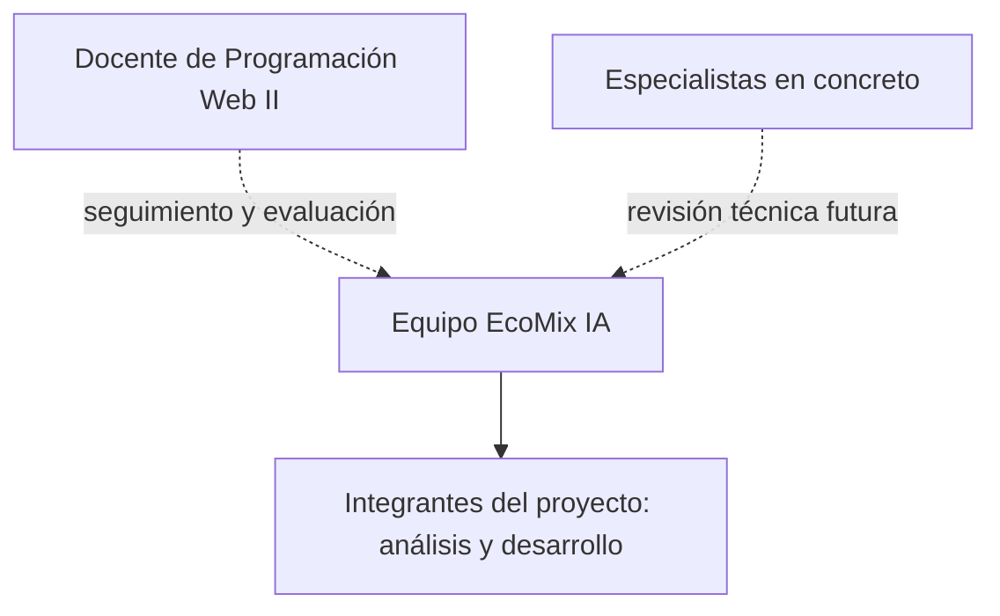
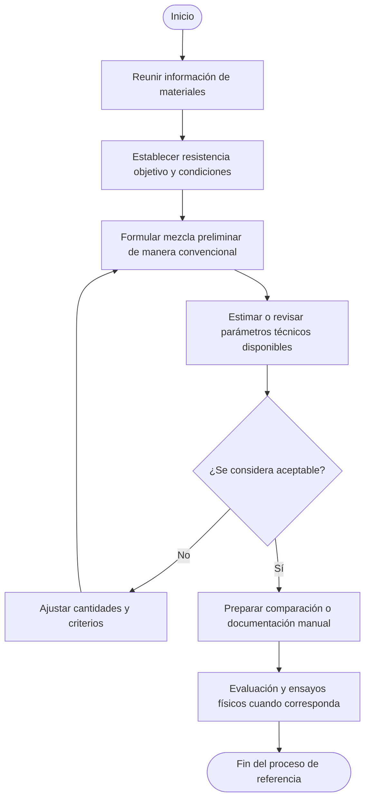
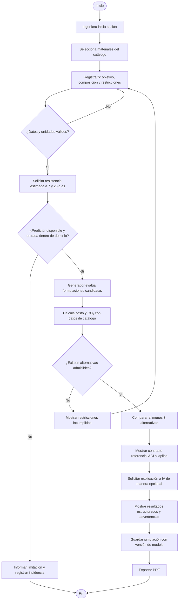
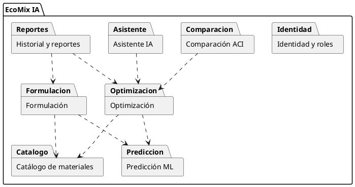
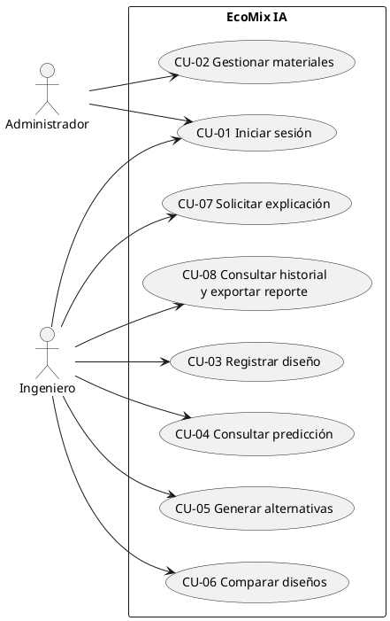
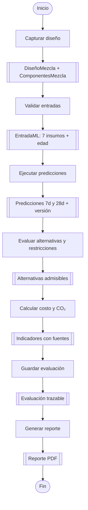
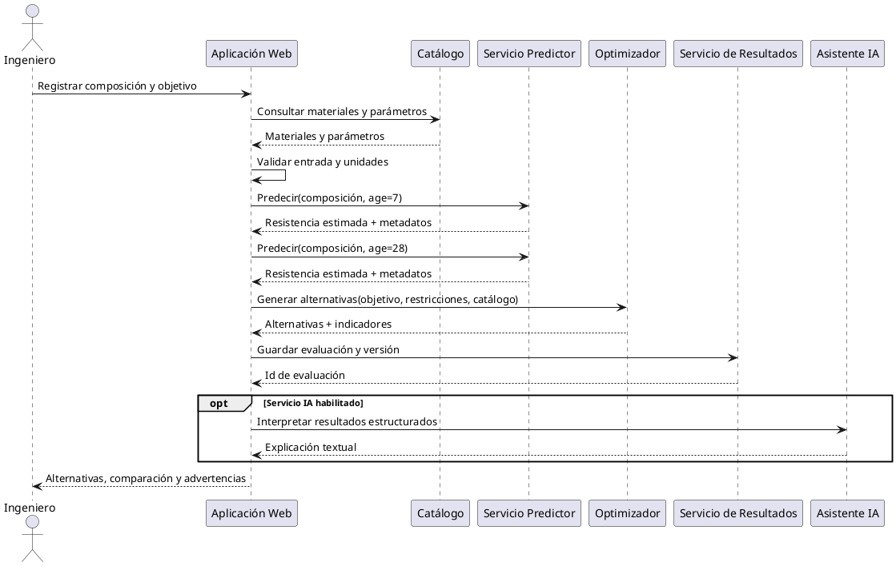
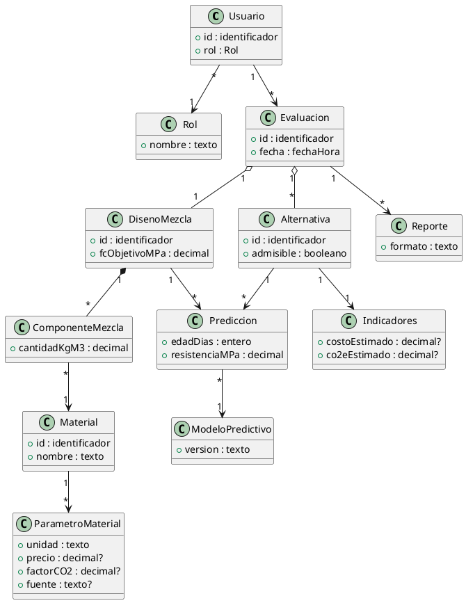

# FD03-EPIS — Informe SRS de Proyecto

## EcoMix IA: Plataforma web inteligente para el diseño y optimización de mezclas de concreto

**Universidad Privada de Tacna**  
**Facultad de Ingeniería — Escuela Profesional de Ingeniería de Sistemas**  
**Asignatura:** Programación Web II  
**Proyecto:** Sistema EcoMix IA  
**Equipo:** Joel Adrián Guillén Laveriano y Joan Cristian Medina Quispe  
**Lugar y año:** Tacna, Perú — 2026  
**Versión:** 0.1 — borrador base para revisión  
**Fecha de elaboración:** 26/10/2026  
**Estado de aprobación:** Pendiente de revisión académica y validación funcional

> **Naturaleza de esta versión.** Este documento es una línea base de trabajo, no una especificación aprobada. La información etiquetada **[FD02]** proviene del *Informe Visión de Proyecto*, versión 1.0, de 12/10/2026. La información etiquetada **[Propuesta FD03]** es una formulación inicial que debe discutirse y aprobarse. **[Pendiente de validar]** identifica decisiones o evidencias que aún no se han obtenido. No se presume la ejecución de entrevistas, encuestas, ensayos técnicos ni despliegues que no consten en la documentación.

## Control de versiones

| Versión | Fecha | Responsable | Estado | Cambio |
|---|---|---|---|---|
| 0.1 | 26/10/2026 | Equipo EcoMix IA | Borrador | Estructura SRS completa y primera redacción fundamentada en FD02. |

## Índice

1. Introducción  
2. Generalidades de la Empresa  
   2.1. Nombre de la Empresa  
   2.2. Visión  
   2.3. Misión  
   2.4. Organigrama  
3. Visionamiento de la Empresa  
   3.1. Descripción del Problema  
   3.2. Objetivos de Negocios  
   3.3. Objetivos de Diseño  
   3.4. Alcance del proyecto  
   3.5. Viabilidad del Sistema  
   3.6. Información obtenida del Levantamiento de Información  
4. Análisis de Procesos  
   4.1. Diagrama del Proceso Actual - Diagrama de actividades  
   4.2. Diagrama del Proceso Propuesto - Diagrama de actividades Inicial  
5. Especificación de Requerimientos de Software  
   5.1. Identificación de Módulos y Capacidades Funcionales  
   5.2. Requerimientos No Funcionales (ISO/IEC 25010)  
   5.3. Matriz Consolidada de Requerimientos Funcionales  
   5.4. Reglas de Negocio  
   5.5. Matriz de Trazabilidad de Requerimientos  
6. Fase de Desarrollo  
   6.1. Perfiles de Usuario  
   6.2. Modelo Conceptual  
      6.2.1. Diagrama de Paquetes  
      6.2.2. Diagrama de Casos de Uso  
      6.2.3. Escenarios de Caso de Uso (narrativa)  
   6.3. Modelo Lógico  
      6.3.1. Análisis de Objetos  
      6.3.2. Diagrama de Actividades con objetos  
      6.3.3. Diagrama de Secuencia  
      6.3.4. Diagrama de Clases  
Conclusiones  
Bibliografía

---

# 1. Introducción

EcoMix IA es una propuesta académica de plataforma web para apoyar la formulación y comparación preliminar de mezclas de concreto convencionales y ecológicas, especialmente aquellas que emplean materiales cementantes suplementarios. El problema de partida consiste en comparar diseños que consideren resistencia mecánica, restricciones técnicas, costo y emisiones estimadas, sin depender exclusivamente de iteraciones manuales y ensayos sucesivos. **[FD02, §§1 y 2]**

El presente **Informe de Especificación de Requerimientos de Software (SRS)** transforma la visión inicial del proyecto en una base de análisis de procesos, funciones, atributos de calidad, reglas de negocio y modelos conceptuales y lógicos. Su propósito es facilitar acuerdos entre el equipo, la revisión docente y la posterior verificación de la implementación, sin anticipar resultados de validación que todavía no existan.

La solución se concibe como **sistema de apoyo a decisiones**: el ingeniero registra materiales y condiciones, consulta predicciones de resistencia, examina alternativas, compara costos y emisiones y documenta sus decisiones. El sistema **no sustituye ensayos de laboratorio, juicio profesional ni evaluación normativa**. La IA generativa únicamente explica resultados numéricos previamente obtenidos mediante fuentes estructuradas o cálculos definidos. **[FD02, §§1.2, 4.1 y 6]**

**Fuentes y criterio de elaboración.** La fuente principal es el FD02, versión 1.0 (12/10/2026). Se utiliza el repositorio `JMedina255/EcoMix-IA-AzureML` como evidencia del componente ML, cuya implementación debe distinguirse de las funciones todavía propuestas. La edición y la aplicación exacta de ISO/IEC 25010 se precisarán durante la revisión de los requerimientos no funcionales. **[Pendiente de validar: evidencia operativa del sistema web completo y entrevistas a especialistas.]**

# 2. Generalidades de la Empresa

> **Advertencia documental:** el FD02 no identifica una empresa operadora formal de EcoMix IA. Esta sección conserva el formato solicitado, pero no atribuye a Yura S.A. funciones de cliente, propietario o patrocinador. Debe confirmarse si la unidad de estudio será el equipo académico, un laboratorio ficticio de caso de estudio o una entidad real.

## 2.1. Nombre de la Empresa

**Denominación de trabajo:** Equipo EcoMix IA — proyecto académico de desarrollo de software, vinculado a la Universidad Privada de Tacna. El nombre del producto es **EcoMix IA**. **[FD02, portada y §§1.1, 2.1]**

**Entidad empresarial formal:** **[Pendiente de validar]**. Yura S.A. figura en el FD02 como referente del reto de innovación, sin que se documente convenio, patrocinio, encargo o adopción del sistema.

## 2.2. Visión

**Visión institucional de una empresa:** **[Pendiente de validar; no consta en FD02.]**

**Visión del producto, como referencia provisional:** ofrecer una plataforma web de apoyo a decisiones que permita ingresar composiciones de mezclas de concreto, estimar resistencia, explorar alternativas de menor costo e impacto ambiental y presentar resultados comprensibles para profesionales técnicos. **[FD02, §1.5]**

*Esta formulación describe al producto; no debe hacerse pasar por una declaración oficial de visión empresarial.*

## 2.3. Misión

**Misión institucional de una empresa:** **[Pendiente de validar; no consta en FD02.]**

**Propósito operativo del proyecto, como propuesta:** desarrollar y evaluar una herramienta académica que integre registro de parámetros, predicción estadística, generación de alternativas, comparación técnica y explicación transparente de resultados, para orientar evaluaciones preliminares de mezclas de concreto. **[Propuesta FD03 basada en FD02, §§1.1, 1.5 y 4.1]**

## 2.4. Organigrama

No existe en el FD02 un organigrama empresarial formal. Para no asignar cargos sin evidencia, se propone únicamente el siguiente **esquema de participación académica**, que **no es un organigrama empresarial**:

**[Pendiente de validar]** Identificar, si corresponde, la entidad usuaria, sus áreas operativas, cargos, responsables de aprobación, administradores y especialistas participantes.

# 3. Visionamiento de la Empresa

## 3.1. Descripción del Problema

El diseño de mezclas puede exigir múltiples propuestas y ensayos, mientras que la información técnica, económica y ambiental suele evaluarse de forma separada. La dificultad central no se limita a predecir resistencia: también comprende mantener catálogos consistentes, aplicar restricciones, comparar escenarios y conservar trazabilidad. El FD02 plantea estas necesidades como **hipótesis que deberán contrastarse con profesionales**. **[FD02, §2.2]**

| Situación identificada en FD02 | Efecto esperado | Respuesta de EcoMix IA |
|---|---|---|
| Iteraciones de dosificación y ensayo | Mayor tiempo para preseleccionar opciones | Simulación y priorización preliminar de formulaciones |
| Información de materiales dispersa | Inconsistencia entre escenarios | Catálogo centralizado con propiedades y fuentes |
| Evaluación separada de resistencia, costo y CO₂ | Comparación difícil | Tablas y gráficos con unidades homogéneas |
| Interpretación técnica compleja | Explicaciones poco accesibles | Explicación contextual de resultados y límites |
| Escasa trazabilidad | Dificultad para reproducir decisiones | Historial con entradas, resultados y versión del modelo |

## 3.2. Objetivos de Negocios

En esta versión, los “objetivos de negocios” se interpretan como **objetivos de valor para usuarios y potenciales organizaciones usuarias**, dado que no existe una empresa propietaria identificada.

| Código | Objetivo preliminar | Evidencia de cumplimiento propuesta |
|---|---|---|
| ON-01 | Facilitar la comparación inicial de formulaciones de concreto | Visualización de al menos tres alternativas con criterios homogéneos |
| ON-02 | Incorporar costo y CO₂ estimados a las decisiones de diseño | Cálculos basados en cantidades y parámetros ambientales/económicos identificables |
| ON-03 | Mejorar la trazabilidad de cada evaluación | Registro de entradas, resultados, fecha y versión del predictor |
| ON-04 | Facilitar la comunicación de resultados técnicos | Historial consultable y reporte exportable con advertencias |
| ON-05 | Disponer de una demostración académica reproducible | Flujo funcional verificable con datos y limitaciones declarados |

**[Propuesta FD03 basada en FD02, §§2, 3.6 y 8]**. Las métricas de impacto empresarial (ahorro de tiempo real, costos evitados, adopción) están **[Pendientes de medir]**.

## 3.3. Objetivos de Diseño

| Código | Objetivo de diseño | Referencia |
|---|---|---|
| OD-01 | Separar la interfaz, las reglas de aplicación, la persistencia, el predictor, el optimizador y el asistente generativo | FD02 §4.1 |
| OD-02 | Validar materiales, cantidades, unidades, edades y parámetros antes de procesar escenarios | FD02 N03 y R-04 |
| OD-03 | Mostrar predicciones a 7 y 28 días para una misma composición usando la edad como entrada | FD02 N04; repositorio ML |
| OD-04 | Generar al menos tres alternativas comparables sujetas a restricciones declaradas | FD02 N05, RF05 |
| OD-05 | Calcular costo y huella ambiental con parámetros externos al dataset UCI | FD02 §§4.1 y 4.4 |
| OD-06 | Conservar los resultados técnicos sin permitir que la IA generativa los modifique | FD02 R-09 |
| OD-07 | Registrar entradas, resultados y versión del modelo para reproducibilidad | FD02 N09 |
| OD-08 | Mantener despliegue y proveedor IA desacoplados de la lógica de dominio | Propuesta FD03; compatibilidad por verificar |

## 3.4. Alcance del proyecto

**Dentro del alcance inicial propuesto [FD02, §1.2]:** autenticación con roles Administrador e Ingeniero; catálogo de materiales, propiedades, precios y factores de emisión; formulario de criterios y composición; predicción de resistencia a 7 y 28 días; generación de al menos tres alternativas; comparación de resistencia, costo y CO₂; contraste referencial con ACI 211; explicación mediante asistente IA; historial y reportes PDF; posibilidad de despliegue web en Azure.

**Fuera del alcance inicial [FD02, §1.2]:** ensayos físicos, sensores IoT, calibración con datos propios de Yura S.A., certificación de cumplimiento normativo, y autorización automática para utilizar una mezcla en obra real.

**Límites técnicos:** el predictor se entrena con datos UCI sobre composición, edad y resistencia; no dispone directamente de costos, factores de CO₂ ni asentamiento. La validez de sus estimaciones para materiales particulares requiere evaluación. El diseño de referencia ACI 211 no equivale a verificación normativa. **[FD02, §§4.1, 4.3 y 6]**

## 3.5. Viabilidad del Sistema

| Dimensión | Evaluación preliminar | Aspectos pendientes |
|---|---|---|
| Técnica | Existe una ruta de preparación de datos y scripts Azure ML; el documento plantea aplicación .NET y SQL Server | Evaluación independiente del modelo, compatibilidad de integración y confirmación del stack web vigente |
| Operativa | Roles y recorrido de usuario definidos a nivel de visión | Validación con ingenieros, usabilidad y condiciones reales de materiales |
| Económica | Se reconoce posibilidad de demo local y uso controlado de Azure estudiantil | Costos verificados de hosting, almacenamiento, API IA, mantenimiento y operación |
| Legal y ética | Se reconoce protección de datos, atribución del dataset y advertencias técnicas | Evaluación de cumplimiento aplicable y licencias concretas |
| Temporal | FD02 prioriza un MVP P1 y ampliaciones P2/P3 | Cronograma de implementación y responsables por entregable |

**Dictamen:** viabilidad **preliminar y condicionada**, no aprobación de factibilidad. Se requiere evidencia técnica, funcional y de costos antes de declarar viable un despliegue operativo. **[Propuesta FD03 a partir de FD02, §§4.3, 4.4, 7 y 8]**

## 3.6. Información obtenida del Levantamiento de Información

**Método documentado a la fecha:** análisis documental del FD02 y de los archivos publicados en el repositorio del componente ML. El FD02 no acredita entrevistas realizadas, encuestas, observaciones de obra o sesiones formales de validación con la empresa. **[FD02, §§2.2 y 3]**

| Fuente | Información levantada | Nivel de evidencia |
|---|---|---|
| FD02 — Informe Visión v1.0 | Necesidades N01–N09, roles, RF01–RF08, restricciones y metas | Documental, propuesta de visión |
| Repositorio EcoMix-IA-AzureML | Preparación de datos UCI, registro de activos, entrenamiento y evaluación prevista | Evidencia de código y artefactos versionados; no prueba integración final |
| Documentación Archify D02 y D03 | Arquitectura objetivo y recorrido funcional ilustrativo | Modelado preliminar; no sustituye validación de usuario |
| Entrevistas a ingenieros/administradores | **[Pendiente de realizar]** | Sin evidencia disponible |
| Observación del proceso real | **[Pendiente de realizar]** | Sin evidencia disponible |

**Preguntas pendientes para el próximo levantamiento:** ¿quién aporta el catálogo de materiales y los precios?, ¿qué restricciones técnicas deben comprobarse?, ¿qué datos precisa el comparador ACI?, ¿cómo aprueba el ingeniero una alternativa?, ¿qué conserva el historial?, ¿qué partes de la aplicación ASP.NET están funcionando realmente?

# 4. Análisis de Procesos

## 4.1. Diagrama del Proceso Actual - Diagrama de actividades

**Estado: hipótesis inicial, pendiente de levantamiento de campo.** El FD02 menciona exploración manual y uso posible de hojas de cálculo, revisiones y ensayos, pero no documenta un procedimiento observado dentro de una organización específica. El siguiente flujo **no es evidencia de un proceso empresarial real**; se usa solo para orientar entrevistas y contrastes posteriores. **[FD02, §§1 y 2]**

**[Pendiente de validar]** Responsable por actividad, herramientas empleadas, frecuencia, tiempos, decisiones y documentos del proceso real. Este flujo no implica que todas las organizaciones sigan esa secuencia.

## 4.2. Diagrama del Proceso Propuesto - Diagrama de actividades Inicial

El flujo propuesto se deriva del recorrido del ingeniero especificado en el FD02. Distingue cálculos técnicos, evaluación de alternativas y explicación de IA como responsabilidades separadas.

**[Propuesta FD03 basada en FD02, §§1.5, 3.3, 4.1 y 5]**. Las rutas de error, el carácter opcional de la explicación y los criterios detallados de admisibilidad requieren validación de casos de uso.

# 5. Especificación de Requerimientos de Software

## 5.1. Identificación de Módulos y Capacidades Funcionales

| Módulo | Capacidades previstas | Requerimientos relacionados | Condición actual de esta SRS |
|---|---|---|---|
| M01. Identidad y acceso | Inicio de sesión, perfil y autorización por rol | RF01 | Definido en visión; verificar implementación |
| M02. Catálogo técnico | CRUD de materiales, propiedades, costos y factores de emisión | RF02 | Definido en visión; validar campos |
| M03. Formulación | Captura de objetivos, cantidades, edad y restricciones | RF03 | Definido en visión; validar reglas de entrada |
| M04. Predicción ML | Inferencia de resistencia a edades definidas | RF04 | Entrenamiento documentado; integración pendiente |
| M05. Optimización y sostenibilidad | Generación de alternativas, cálculo de costo y CO₂ | RF05 | Definir algoritmo, restricciones y fuentes |
| M06. Comparación técnica | Tablas y gráficos, contraste con referencia ACI 211 | RF06 | Precisar datos y método de referencia |
| M07. Explicación asistida | Interpretación legible de resultados estructurados | RF07 | Definir proveedor e instrucciones seguras |
| M08. Trazabilidad y reportes | Historial, recuperación, exportación PDF | RF08; N09 | Definir entidad de evaluación y formato de informe |

**Nota de versión:** esta división modular es de análisis, **no prueba** que existan ocho servicios independientes ni que estén implementados. **[Propuesta FD03 basada en FD02, §5]**

## 5.2. Requerimientos No Funcionales (ISO/IEC 25010)

Los siguientes son requerimientos preliminares organizados por atributos de calidad. **[Pendiente de validar]** la edición de ISO/IEC 25010 utilizada por la asignatura, sus categorías formales y los protocolos de medición. No se presume cumplimiento por el solo hecho de definir una meta.

| ID | Atributo de calidad | Requerimiento preliminar y criterio de comprobación | Fuente/estado |
|---|---|---|---|
| RNF-01 | Eficiencia de desempeño | La consulta de predicción deberá responder en menos de 2 segundos en el entorno de prueba acordado | FD02 §7; meta pendiente de medir |
| RNF-02 | Eficiencia de desempeño | La solicitud ordinaria de optimización deberá completarse en menos de 10 segundos en escenarios definidos | FD02 §7; meta pendiente de medir |
| RNF-03 | Usabilidad | Las vistas del flujo principal deberán ser utilizables en escritorio y móvil, con mensajes de validación comprensibles | FD02 §7; definir casos y dispositivos |
| RNF-04 | Seguridad | Controlar acceso por rol y proteger credenciales fuera del código público | FD02 R-08 y §7; verificar controles |
| RNF-05 | Seguridad | Emplear HTTPS para comunicaciones de servicios web desplegados | FD02 §9; comprobar entorno |
| RNF-06 | Integridad y confiabilidad | Conservar entradas, resultados y versión del predictor de cada simulación sin alteraciones silenciosas | FD02 N09 y §7; probar persistencia |
| RNF-07 | Transparencia y uso responsable | Etiquetar predicciones como estimaciones y declarar supuestos, unidades y límites | FD02 §7; revisión funcional |
| RNF-08 | Compatibilidad/interoperabilidad | Establecer un contrato versionado de entrada/salida entre backend .NET y predictor seleccionado | Propuesta FD03; tecnología pendiente |
| RNF-09 | Mantenibilidad | Permitir sustituir el proveedor de IA generativa sin cambiar la lógica numérica del sistema | FD02 §9; verificar desacoplamiento |
| RNF-10 | Portabilidad/despliegue | Mantener procedimiento reproducible de ejecución local y configuración externa de secretos | FD02 §4.5; comprobar instalación limpia |

**Meta específica de calidad predictiva (fuera de una clasificación automática de calidad software):** alcanzar **R² ≥ 0.85** en evaluación con datos de prueba independientes y registrar además los errores de predicción. El valor es una **meta inicial no verificada** y no debe confundirse con precisión asegurada. **[FD02, §7]**

## 5.3. Matriz Consolidada de Requerimientos Funcionales

Los códigos RF01–RF08 son los definidos por el FD02. Para esta versión se formulan conductas observables y criterios de aceptación preliminares sin declarar su aprobación formal.

| ID | Requerimiento funcional | Actor | Criterio preliminar de aceptación | Prioridad de implementación FD02 |
|---|---|---|---|---|
| RF01 | Autenticación y acceso diferenciado por perfil Administrador/Ingeniero | Ambos | Acceso autorizado y rechazo de funciones restringidas al rol incorrecto | P2 en precedencia; necesidad N01 alta |
| RF02 | Crear, consultar y modificar catálogo de materiales y parámetros asociados | Administrador | Material y datos asociados se registran, validan y recuperan | P1 |
| RF03 | Registrar parámetros y criterios de una mezcla | Ingeniero | Datos y unidades son validados; errores se señalan | P1 |
| RF04 | Estimar resistencia a compresión a 7 y 28 días | Ingeniero/sistema | Se muestran predicciones, edad usada y versión del modelo | P1 |
| RF05 | Generar al menos tres alternativas comparables cuando existan soluciones admisibles | Ingeniero/sistema | Alternativas incluyen estimaciones de resistencia, costo y CO₂, con restricciones explícitas | P1 |
| RF06 | Contrastar alternativas con diseño de referencia ACI 211 | Ingeniero | Tabla o gráfico con bases de comparación homogéneas y alcance referencial | P2; comparación tabular simple se prioriza P1 |
| RF07 | Mostrar explicación de criterios, compensaciones y límites | Ingeniero | Texto basado en resultados estructurados, sin modificar cifras | P2 |
| RF08 | Consultar evaluaciones previas y exportar informe PDF | Ingeniero | Historial recuperable y PDF con datos, resultados y advertencias | P2 |

**Aclaración:** la diferencia entre la prioridad alta de N01 y la precedencia P2 de RF01 existe en el FD02. Debe acordarse antes de cerrar el plan de implementación. **[FD02, §§3.6, 5 y 8]**

## 5.4. Reglas de Negocio

Las siguientes reglas **RN** son derivaciones de necesidades y restricciones del FD02, no una aprobación de reglas operativas por un cliente.

| ID | Regla de negocio preliminar | Origen |
|---|---|---|
| RN-01 | Un usuario solo puede ejecutar acciones permitidas para su rol | RF01; N01 |
| RN-02 | Las cantidades y edades deben ser numéricamente válidas y sus unidades explícitas | N03; R-04 |
| RN-03 | La edad es una entrada del predictor; para 7 y 28 días se evaluará la misma dosificación con cada edad | RF04; FD02 §4.1 |
| RN-04 | La resistencia objetivo f'c es criterio del diseño/optimizador, no una variable del predictor UCI | Dataset UCI; FD02 §4.1 |
| RN-05 | El costo estimado se obtiene de cantidades por precios unitarios, con unidades y fuentes compatibles | FD02 §4.4 |
| RN-06 | El CO₂e estimado se obtiene de cantidades por factores de emisión, con fuentes y alcance declarados | FD02 §4.4; R-07 |
| RN-07 | Si faltan parámetros económicos o ambientales, no deben presentarse resultados numéricos inventados | R-07; FD02 §4.3 |
| RN-08 | Una alternativa se considera admisible solo respecto de restricciones y objetivos expresamente definidos | RF05; FD02 §5 |
| RN-09 | La referencia ACI 211 es comparativa y no certifica la mezcla | R-06; FD02 §9 |
| RN-10 | El asistente generativo no puede alterar predicciones ni cálculos del sistema | R-09; RF07 |
| RN-11 | Cada simulación conservada debe referenciar parámetros, resultados y versión del modelo | N09; RF08 |
| RN-12 | Los resultados de EcoMix IA son orientativos y requieren revisión profesional y validación experimental | FD02 §§1.2 y 6 |

## 5.5. Matriz de Trazabilidad de Requerimientos

Esta matriz inicial relaciona fuentes, módulos y artefactos de diseño. La evidencia de prueba se incorporará durante desarrollo y validación.

| RF | Necesidad FD02 | Módulo | Caso de uso preliminar | Evidencia de prueba |
|---|---|---|---|---|
| RF01 | N01 | M01 | CU-01 Iniciar sesión | Pendiente |
| RF02 | N02 | M02 | CU-02 Gestionar materiales | Pendiente |
| RF03 | N03 | M03 | CU-03 Registrar diseño | Pendiente |
| RF04 | N04 | M04 | CU-04 Consultar predicción | Pendiente |
| RF05 | N05 | M05 | CU-05 Generar alternativas | Pendiente |
| RF06 | N06 | M06 | CU-06 Comparar diseños | Pendiente |
| RF07 | N07 | M07 | CU-07 Solicitar explicación | Pendiente |
| RF08 | N08; N09 | M08 | CU-08 Consultar historial y exportar | Pendiente |

**Trazas transversales:** N09 también afecta RF03–RF07 por la necesidad de reproducir entradas y salidas; RNF-04 y RNF-05 afectan todos los módulos expuestos por la web. Los criterios de aceptación y los identificadores de pruebas se completarán en versiones posteriores.

# 6. Fase de Desarrollo

> Los modelos de esta sección son **conceptuales y preliminares**. No constituyen ingeniería inversa confirmada de los modelos C#, Entity Framework o de los artefactos Azure existentes. Su validación es parte del trabajo futuro.

## 6.1. Perfiles de Usuario

| Perfil | Propósito | Responsabilidades | Restricciones de acceso |
|---|---|---|---|
| Administrador | Mantener condiciones para operar el sistema | Gestionar cuentas, permisos, materiales, precios y factores de emisión | No asumir funciones adicionales sin requisito aprobado |
| Ingeniero | Diseñar y analizar formulaciones preliminares | Capturar parámetros, predecir, generar y comparar alternativas, consultar reportes | Acceso limitado a sus diseños conforme a políticas que se definan |

**[FD02, §§3.2, 3.3 y 3.5]**. No se incorporan perfiles de operador, jefe de laboratorio o auditor sin validación de su necesidad.

## 6.2. Modelo Conceptual

El modelo conceptual describe qué responsabilidades y procesos integran el sistema. La asignación a proyectos físicos, repositorios y tecnologías concretas debe confirmarse mediante revisión del sistema web y del módulo de inferencia.

### 6.2.1. Diagrama de Paquetes

**Borrador PlantUML; no validado.** Los paquetes representan áreas funcionales y no necesariamente ensamblados desplegables:

### 6.2.2. Diagrama de Casos de Uso

**Borrador PlantUML; sujeto a revisión de alcance y relaciones `include/extend`:**

### 6.2.3. Escenarios de Caso de Uso (narrativa)

**CU-02 — Gestionar materiales.** Actor principal: Administrador. Precondición: cuenta autorizada. Flujo básico: acceder al catálogo, seleccionar alta o edición, registrar nombre, propiedades, unidad, precio y factor ambiental cuando corresponda, validar campos y persistir cambios. Alternativas: campos inválidos, unidades incompatibles o ausencia de fuente verificable. Postcondición: información disponible para formular nuevos escenarios. **[Propuesta FD03; RF02]**

**CU-03 — Registrar diseño.** Actor principal: Ingeniero. Precondición: acceso autorizado y catálogo disponible. Flujo básico: seleccionar materiales, ingresar cantidades, resistencia objetivo y criterios técnicos; el sistema valida y crea un escenario identificable. Alternativas: cantidades no válidas, materiales incompletos y restricciones incompatibles. Postcondición: diseño listo para solicitar estimación. **[Propuesta FD03; RF03]**

**CU-04 — Consultar predicción.** Actor principal: Ingeniero. Precondición: diseño validado y predictor disponible. Flujo básico: preparar las ocho variables del predictor UCI (siete cantidades y edad), efectuar las consultas para 7 y 28 días cuando correspondan, y mostrar estimaciones, unidades, versión del modelo y advertencias. Alternativas: incompatibilidad de variables, servicio no disponible y condiciones fuera del dominio de entrenamiento. Postcondición: estimaciones registrables sin presentarse como certificación. **[Propuesta FD03; RF04]**

**CU-05 — Generar alternativas.** Actor principal: Ingeniero. Precondición: criterios de diseño, costos, factores ambientales y predictor disponibles. Flujo básico: producir candidatas, validar restricciones, obtener estimaciones y ordenar opciones comparables; mostrar al menos tres si son admisibles. Alternativas: no existen tres candidatas, datos económicos/ambientales incompletos, falta de convergencia. Postcondición: alternativas y fundamentos disponibles. **[Propuesta FD03; RF05]**

**CU-08 — Consultar historial y exportar reporte.** Actor principal: Ingeniero. Precondición: evaluación persistida y autorizada. Flujo básico: buscar evaluación, revisar entradas y resultados, descargar reporte PDF. Alternativas: evaluación inexistente, usuario sin permiso o exportación fallida. Postcondición: consulta o reporte generado sin alterar los registros originales. **[Propuesta FD03; RF08]**

**[Pendiente de completar]** Narrativas formales de CU-01, CU-06 y CU-07; identificadores de mensajes, condiciones de extensión y pruebas de aceptación.

## 6.3. Modelo Lógico

### 6.3.1. Análisis de Objetos

Se identifican las siguientes **clases conceptuales candidatas**; los nombres definitivos y atributos deberán contrastarse con el esquema real de persistencia.

| Objeto conceptual | Responsabilidad | Relaciones previstas |
|---|---|---|
| Usuario | Representar acceso y titularidad de simulaciones | Rol, Evaluación |
| Rol | Definir funciones autorizadas | Usuario |
| Material | Representar insumo técnico del catálogo | ComponenteMezcla, ParámetroMaterial |
| ParámetroMaterial | Conservar precio, factor de emisión, unidad y fuente | Material |
| DiseñoMezcla | Registrar objetivo, edad/restricciones y contexto | ComponenteMezcla, Evaluación |
| ComponenteMezcla | Asociar un material y su cantidad por volumen | DiseñoMezcla, Material |
| ModeloPredictivo | Identificar versión y características del modelo usado | Predicción |
| Predicción | Conservar edad y resistencia estimada | DiseñoMezcla/Alternativa, ModeloPredictivo |
| Alternativa | Representar formulación candidata y admisibilidad | DiseñoMezcla, Predicción, Indicadores |
| Indicadores | Registrar costo y CO₂ estimados con supuestos | Alternativa |
| Evaluación | Agrupar resultados, fecha y trazabilidad | Usuario, DiseñoMezcla, Alternativas, Reporte |
| Reporte | Representar exportación/documentación de evaluación | Evaluación |

**[Propuesta FD03]**. Entidades concretas, claves, cardinalidades y tipos deben confirmarse con EF/SQL Server.

### 6.3.2. Diagrama de Actividades con objetos

**Borrador conceptual de flujo y objetos de información.** Las cajas con corchetes designan objetos/datos transferidos, no clases de implementación verificadas:

### 6.3.3. Diagrama de Secuencia

**Borrador PlantUML del caso principal.** Su interfaz de inferencia es una abstracción; aún debe definirse si la comunicación real se realizará mediante un servicio Python, modelo descargado compatible u otra alternativa.

**[Pendiente de validar]** Órdenes de invocación, responsabilidades transaccionales, manejo de errores, integración ASP.NET–Python y contrato de API.

### 6.3.4. Diagrama de Clases

**Borrador de clases conceptuales**, no esquema físico de base de datos. Solo refleja relaciones principales para orientar la discusión.

**[Pendiente de validar]** Cardinalidades, preservación de versiones históricas de precios, tratamiento de alternativas sin tres soluciones admisibles y existencia de tablas equivalentes.

# Conclusiones

Este documento establece una **primera base revisable de especificación de requerimientos** para EcoMix IA, vinculando los ocho requisitos funcionales del FD02 con módulos, criterios de calidad, reglas de negocio, casos de uso y modelos preliminares. El sistema se entiende como una plataforma integral de apoyo a decisiones, y el predictor ML como un componente especializado.

La principal limitación de esta versión es de **evidencia y definición**, no de redacción: faltan una entidad empresarial formal definida, levantamiento de campo con especialistas, validación de procesos actuales, criterios detallados de optimización, confirmación del stack web final y pruebas de aceptación. Los diagramas son borradores para discusión, no modelos UML aprobados.

La evolución a una versión 0.2 debería priorizar la revisión y aprobación de las secciones 2 y 3, antes de consolidar los flujos (sección 4), la matriz de requisitos (sección 5) y los modelos UML (sección 6). Se mantendrá trazabilidad con el FD02 y con los repositorios de implementación.

# Bibliografía

1. Equipo EcoMix IA. (2026). *FD02-EPIS — Informe Visión de Proyecto: EcoMix IA*, versión 1.0, 12 de octubre de 2026. Universidad Privada de Tacna. **Fuente documental principal.**
2. Equipo EcoMix IA. (2026). *EcoMix-IA-AzureML* [Repositorio de código y documentación]. GitHub: https://github.com/JMedina255/EcoMix-IA-AzureML. **Fuente técnica para estado del módulo ML; revisión documental de 26/10/2026.**
3. UCI Machine Learning Repository. *Concrete Compressive Strength (dataset ID 165)*. https://archive.ics.uci.edu/dataset/165/concrete+compressive+strength. **Referencia identificada en FD02; datos usados por el módulo ML.**
4. American Concrete Institute. *ACI PRC-211.1-22*. **Documento de referencia citado en FD02; verificar edición y procedimiento aplicable en la especificación detallada.**
5. ISO/IEC 25010. *Modelo de calidad de producto software*. **Referencia normativa indicada en el índice FD03; edición de trabajo y categorías pendientes de precisar.**

---

**Revisión propuesta para la versión 0.2:** definición de la organización usuaria (sección 2), contraste del proceso real y propuesto (sección 4) y aprobación inicial de RF/RNF/RN (sección 5). Hasta entonces, esta versión 0.1 debe circular expresamente como borrador.
