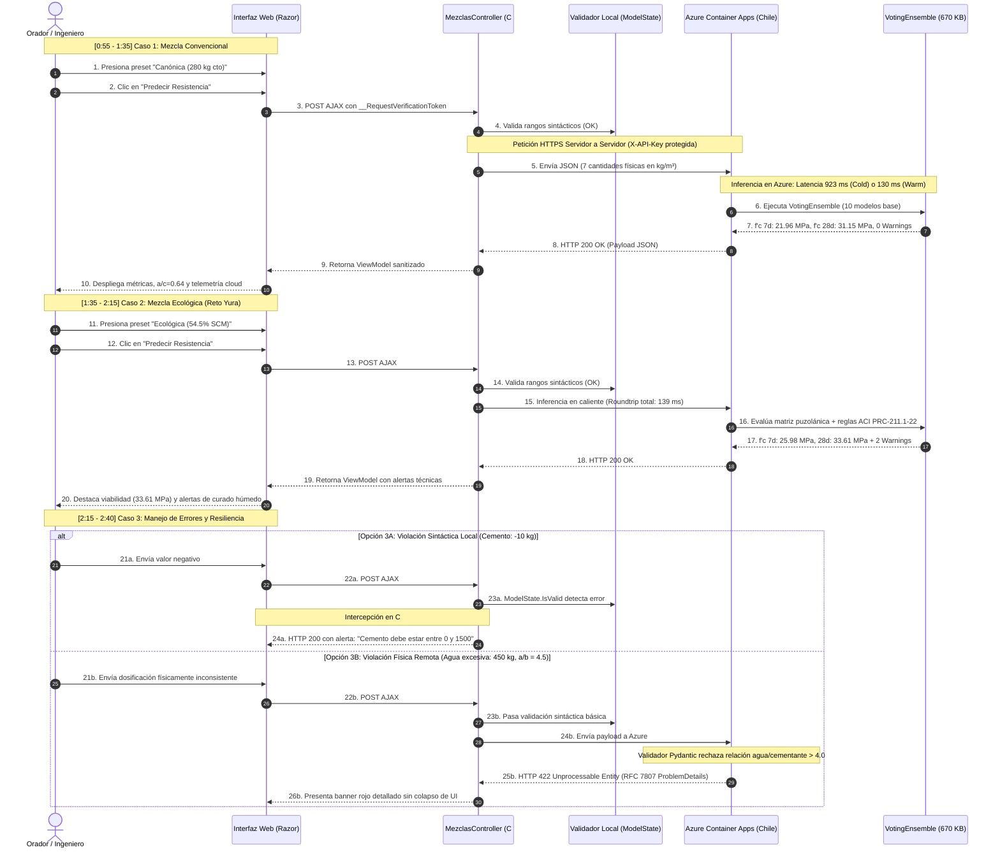

# Guion de Exposición Técnica y Demostración en Vivo — EcoMix IA
## Sustentación de Avance: Integración Web ASP.NET MVC 5 y Machine Learning en Azure

**Duración Total:** 3 minutos exactos (180 segundos)  
**Audiencia:** Jurado Evaluador Hackathon Innova Sur 2026 / Reto 2 Yura S.A.  
**Roles del Equipo:**  
- **Orador Principal (Expositor):** Expone la visión técnica, decisiones de arquitectura y métricas.  
- **Operador de Consola/Navegador (Piloto):** Ejecuta la interacción en la interfaz web sincronizado con las palabras del orador.  

---

## 1. Diagrama de Secuencia Oficial Corregido

---

## 2. Cronograma Minuto a Minuto del Discurso

### Bloque 1: Introducción y Arquitectura Híbrida (0:00 – 0:30)
- **Diapositivas:** 1 y 2
- **Acción en pantalla:** El operador proyecta la diapositiva 1 y luego pasa a la diapositiva 2 mostrando el diagrama arquitectónico.
- **Voz del Orador:**
  > *"Buenos días, miembros del jurado. En el marco del Reto 2 de Yura S.A., presentamos la plataforma EcoMix IA. Nuestro propósito es optimizar dosificaciones de concreto ecológico minimizando costo y huella de carbono mediante sustitución de clínker por puzolana y escoria, asegurando la resistencia requerida.*
  > 
  > *Arquitectónicamente, diseñamos una integración híbrida desacoplada: el sistema empresarial opera sobre ASP.NET MVC 5 en .NET Framework 4.7.2, mientras que el motor de inferencia corre sobre un contenedor Linux especializado en Microsoft Azure Container Apps. La comunicación es estrictamente de servidor a servidor vía HTTPS, garantizando que ninguna clave criptográfica sea expuesta al navegador del cliente."*

---

### Bloque 2: Machine Learning Certificado y Costos en la Nube (0:30 – 0:55)
- **Diapositivas:** 3 y 4
- **Acción en pantalla:** El operador muestra la diapositiva 3 con las métricas del VotingEnsemble y la diapositiva 4 con la infraestructura de Azure.
- **Voz del Orador:**
  > *"El corazón predictivo es un modelo VotingEnsemble entrenado con AutoML sobre 1,030 ensayos del repositorio UCI 165. En su conjunto de prueba independiente de 206 observaciones, alcanza un coeficiente de determinación $R^2$ de 0.912 y un error medio de solo 3.48 MPa.*
  > 
  > *Este modelo de 670 KB se encuentra publicado en la región Chile Central. Para optimizar el crédito estudiantil, configuramos escalado a cero réplicas: cuando el sistema está inactivo, el consumo de cómputo es de exactamente cero dólares por hora. El único costo fijo es el almacenamiento básico de la imagen en Azure Container Registry, que representa aproximadamente cinco dólares mensuales."*

---

### Bloque 3: Demostración en Vivo — Caso 1: Mezcla Convencional (0:55 – 1:35)
- **Diapositiva:** 5 / Cambio a pantalla del Simulador Web (`https://localhost:44357/Mezclas/Simulador`).
- **Acción en pantalla:** El operador abre el navegador, pulsa el botón del preset **«Canónica (280 kg cto)»** y hace clic en **«Predecir Resistencia con EcoMix IA»**.
- **Voz del Orador:**
  > *"Pasamos a la demostración en vivo. En el simulador, seleccionamos una mezcla de referencia convencional: 280 kg de cemento por metro cúbico, 180 litros de agua y cero sustitución ecológica, con una relación agua/cemento de 0.64.*
  > 
  > *Al solicitar la predicción, la aplicación despacha la petición AJAX protegida con CSRF. El servidor C# consulta nuestro endpoint en Chile Central y el VotingEnsemble devuelve en pantalla: 21.96 MPa a los 7 días y 31.15 MPa a los 28 días. Al ser una proporción balanceada tradicional, el motor analítico no dispara advertencias del código ACI."*

---

### Bloque 4: Demostración en Vivo — Caso 2: Mezcla Ecológica y Reglas ACI (1:35 – 2:15)
- **Diapositiva:** 6 / Continuación en el Simulador Web.
- **Acción en pantalla:** El operador pulsa el botón del preset **«Ecológica (54.5% SCM)»** y hace clic en **«Predecir Resistencia con EcoMix IA»**.
- **Voz del Orador:**
  > *"Ahora abordamos el núcleo del Reto 2 de Yura S.A. Pulsamos el preset 'Ecológica'. Reducimos el cemento a 150 kg por metro cúbico e introducemos 100 kg de escoria y 80 kg de ceniza volante, alcanzando un 54.5% de sustitución de clínker.*
  > 
  > *Observen la inmediatez: con el contenedor en caliente, la inferencia toma apenas 139 milisegundos. El modelo estima 25.98 MPa a 7 días y 33.61 MPa a 28 días, demostrando la viabilidad técnica de alcanzar la resistencia objetivo de 25 MPa con una drástica reducción de emisiones.*
  > 
  > *Crucialmente, el sistema no es una caja negra: activa de inmediato dos advertencias normativas del código ACI PRC-211, advirtiendo al constructor que, debido a la cinética de hidratación lenta de las puzolanas, es imperativo prolongar el curado húmedo."*

---

### Bloque 5: Demostración Caso 3 — Resiliencia y Doble Validación (2:15 – 2:40)
- **Diapositiva:** 7 / Continuación en el Simulador Web.
- **Acción en pantalla:** El operador pulsa el preset **«Inválida»** y presiona **«Predecir Resistencia con EcoMix IA»**, mostrando la alerta en pantalla.
- **Voz del Orador:**
  > *"La robustez es fundamental. Diseñamos una defensa en dos niveles. Si un usuario ingresa valores sintácticamente absurdos, como un peso negativo, el validador local de ASP.NET lo intercepta en 8 milisegundos sin consumir saldo en Azure.*
  > 
  > *Si los valores superan la validación sintáctica pero violan relaciones físicas admisibles de la tecnología del concreto, el microservicio FastAPI en Azure responde con código HTTP 422 bajo el estándar RFC 7807 ProblemDetails. Como se aprecia, la interfaz web gestiona el error de manera controlada y descriptiva, garantizando alta disponibilidad."*

---

### Bloque 6: Responsabilidad Profesional y Cierre (2:40 – 3:00)
- **Diapositiva:** 8
- **Acción en pantalla:** El operador regresa a la presentación proyectando la diapositiva final.
- **Voz del Orador:**
  > *"Para concluir, enfatizamos nuestro principio de gobernanza técnica: las predicciones de EcoMix IA representan estimaciones estadísticas de alta fidelidad para la exploración y optimización de mezclas; de ninguna manera constituyen una certificación estructural ni reemplazan los ensayos destructivos obligatorios de rotura de probetas conforme a la Norma Técnica Peruana 339.034 y ASTM C39 bajo la firma del ingeniero calculista.*
  > 
  > *EcoMix IA une sostenibilidad, rigor normativo e inteligencia artificial moderna en Azure. Quedamos a su disposición para sus preguntas."*

---

## 3. Pautas Críticas para los Presentadores

| Regla de Oro | Lo que NUNCA debe decirse | Lo que DEBE decirse |
|---|---|---|
| **Responsabilidad Estructural** | ❌ *"El software certifica que la estructura no se caerá."* | ✔️ *"El modelo proporciona una estimación predictiva sustentada ($R^2=0.912$) como soporte a la toma de decisiones del ingeniero."* |
| **Norma Técnica** | ❌ *"Con este software ya no se necesita romper probetas en laboratorio."* | ✔️ *"El sistema guía la dosificación óptima, pero los ensayos físicos de rotura de probetas según NTP 339.034 siguen siendo obligatorios."* |
| **Costos en Azure** | ❌ *"La nube de Azure no nos cuesta absolutamente nada."* | ✔️ *"El cómputo en Container Apps escala a cero réplicas (\$0.00 en reposo), requiriendo únicamente el costo fijo de almacenamiento en ACR (~5 USD/mes)."* |
| **Tiempos de Respuesta** | ❌ *"Siempre responde en menos de 100 milisegundos."* | ✔️ *"En caliente responde en 130–150 ms; si el clúster despierta desde cero réplicas, el arranque en frío toma aproximadamente 8.4 segundos."* |
