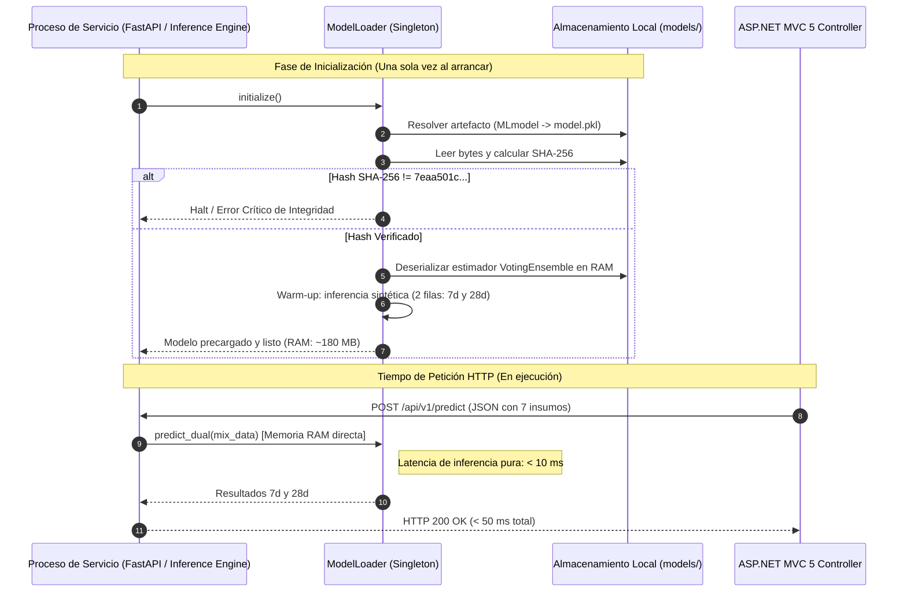
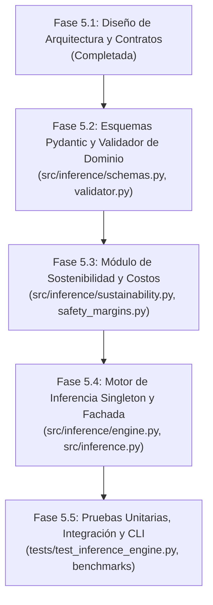

# Documento de Diseño Técnico — Fase 5.1: Motor de Inferencia EcoMix IA

**Proyecto:** EcoMix IA (`ecomix-ia-ml`)  
**Fase:** 5.1 — Especificación y Diseño del Motor de Inferencia  
**Línea Base Git:** [`2d3d75c48a7635dbb88b92987cbba4455a41f8c2`](https://github.com/JMedina255/EcoMix-IA-AzureML/commit/2d3d75c48a7635dbb88b92987cbba4455a41f8c2)  
**Rama de Trabajo:** `feat/phase-05-inference-service`  
**Consumidor Principal:** Plataforma Web ASP.NET MVC 5 (C#, Razor, Entity Framework 6, SQL Server)  
**Rol:** Arquitecto de Software y MLOps  
**Fecha:** 6 de Noviembre de 2026  

---

## 1. Contexto de Negocio y Visión de Integración

### 1.1 El Ecosistema EcoMix IA
EcoMix IA es una solución integral orientada a la descarbonización de la construcción (desarrollada en el marco del Reto 2 de Yura S.A.). El sistema permite dosificar concreto ecológico sustituyendo clínker/cemento Portland por materiales cementantes suplementarios (SCMs): **escoria de alto horno** y **ceniza volante / puzolana**, optimizando simultáneamente la resistencia a compresión ($f'_c$), el costo ($\text{S/./m}^3$) y la huella de carbono ($\text{kg CO}_2\text{e/m}^3$).

### 1.2 Interacción con la Aplicación ASP.NET MVC 5
La arquitectura general (documentada formalmente en FD02, FD03 y el Portal Archify 3.2 — Diagramas D02 y D03) desacopla físicamente la aplicación web monolítica del núcleo analítico de Machine Learning:

```mermaid
flowchart LR
    subgraph Frontend_Backend_Web["Plataforma Web (Monolito ASP.NET MVC 5)"]
        UI["Vistas Razor (Bootstrap 3/5)<br/>Formulario de Dosificación"]
        Controller["ConcreteMixController (C#)"]
        DB[("SQL Server (EF6)<br/>Dosificaciones y Ensayos")]
        UI -->|POST Form| Controller
        Controller -->|Persistencia| DB
    end

    subgraph ML_Inference_Service["Servicio de Inferencia EcoMix (Python / FastAPI)"]
        Validator["Validador de Entrada y Dominio UCI 165"]
        Engine["Motor de Inferencia Singleton<br/>VotingEnsemble MLflow"]
        Sustain["Calculador Analítico de Sostenibilidad<br/>(CO2 y Costos)"]
        Safety["Evaluador de Sobrediseño<br/>(ACI PRC-211.1-22 / 214R)"]
        
        Validator --> Engine
        Engine --> Sustain
        Sustain --> Safety
    end

    Controller -->|HTTP POST JSON (7 Insumos)| Validator
    Safety -->|HTTP 200 JSON (Dual 7d/28d + CO2 + Costos)| Controller
    Controller -->|Renderiza Gráficos y Dossier| UI
```

---

## 2. Análisis del Modelo y Dependencias del Runtime

### 2.1 Especificaciones Técnicas del Modelo Ganador
- **Nombre Canónico:** `VotingEnsemble` (Child Run: `wheat_cheese_4swj34tkjn_11`).
- **Activo Registrado (Model Asset):** `azureml_wheat_cheese_4swj34tkjn_11_output_mlflow_log_model_873731674:1`.
- **Hash Criptográfico (`model.pkl`):** `7eaa501c5eeb60135effb6b5861e736518ce969c47afd53727c2451083ff6388`.
- **Tamaño en Disco:** 670,849 bytes (~655.1 KB).
- **Rendimiento Independiente Certificado (Fase 4.4):**
  - Global ($n = 206$): $R^2 = \mathbf{0.9121}$, $\text{RMSE} = \mathbf{4.7592}\text{ MPa}$, $\text{MAE} = \mathbf{3.2822}\text{ MPa}$.
  - Sin solapamiento ($n = 195$): $R^2 = \mathbf{0.9174}$, $\text{RMSE} = \mathbf{4.5870}\text{ MPa}$.
  - Segmentado a 7 días ($n = 32$): $R^2 = \mathbf{0.8841}$, $\text{RMSE} = \mathbf{5.1725}\text{ MPa}$.
  - Segmentado a 28 días ($n = 75$): $R^2 = \mathbf{0.8235}$, $\text{RMSE} = \mathbf{5.5930}\text{ MPa}$.

### 2.2 Requisitos Estrictos de Runtime
De acuerdo con los metadatos de `MLmodel` y `conda.yaml`:
- **Python:** `3.10.19` (o runtime compatible Python 3.10.x).
- **Scikit-Learn:** `1.5.1`.
- **MLflow:** `2.15.1`.
- **Dependencia Crítica AutoML:** La clase estimadora base es `azureml.training.tabular.models.voting_ensemble.PreFittedSoftVotingRegressor`. Por lo tanto, el entorno de despliegue requiere `azureml-training-tabular` o un entorno virtual/contenedor alineado para deserialización fiel sin advertencias ni distorsiones numéricas.

---

## 3. Arquitectura Modular del Motor de Inferencia en Python

El motor de inferencia se estructurará bajo el principio de responsabilidad única (SRP), alta cohesión y bajo acoplamiento:

```text
src/
├── inference/
│   ├── __init__.py               # Fachada y exportación del motor
│   ├── config.py                 # Constantes, límites de dominio y rutas
│   ├── schemas.py                # Modelos Pydantic v2 (Request, Response, Errors)
│   ├── validator.py              # Validación de entradas, ratios y detección OOD
│   ├── model_loader.py           # Patrón Singleton con verificación de hash SHA-256
│   ├── engine.py                 # Orquestador de inferencia dual (7d y 28d)
│   ├── sustainability.py         # Cálculos analíticos de huella de carbono y costos
│   └── safety_margins.py         # Criterios de sobrediseño (ACI PRC-211.1-22 / 214R)
└── inference.py                  # Entrypoint CLI y fachada pública unificada
```

### 3.1 Desacoplamiento de Responsabilidades
1. **`model_loader.py` (Singleton & Warm Start):**  
   Garantiza que el modelo binario se cargue en memoria **una sola vez al iniciar el proceso**. Verifica el hash SHA-256 antes de admitir inferencias y ejecuta un *warm-up* sintético.
2. **`validator.py` (Integridad y Dominio):**  
   Verifica que los 7 insumos ingresados sean números válidos, no negativos y que se encuentren dentro del hipervolumen de entrenamiento (UCI 165). Calcula la relación agua/cementante ($a/c$ y $a/mc$).
3. **`engine.py` (Inferencia Dual):**  
   Construye las matrices NumPy para `age = 7` y `age = 28`, delegando la predicción en el pipeline en memoria.
4. **`sustainability.py` (Ecológico y Financiero):**  
   Aplica las ecuaciones maestras de FD02 y FD03 para cuantificar emisiones de $\text{CO}_2\text{e}$ y costos unitarios en Soles (S/.), contrastando contra mezclas patrón de referencia.
5. **`safety_margins.py` (Ingeniería Civil):**  
   Aplica el factor de sobrediseño sugerido para mitigar el RMSE observado de $5.59\text{ MPa}$ a 28 días.

---

## 4. Diseño del Contrato de Inferencia (Contratos JSON)

### 4.1 Principio de Diseño de Entrada
En las plantas de premezclado y obras civiles, el ingeniero ingresa la dosificación de insumos requerida para fabricar **un metro cúbico ($1\text{ m}^3$)** de concreto fresco. **No ingresa la variable `age` dos veces**; el motor de inferencia automáticamente expande la dosificación a las dos edades normativas: 7 días y 28 días.

### 4.2 Esquema JSON de Solicitud (Request Contract)

**Especificación Contractual:** `POST /api/v1/predict/concrete-strength`

> [!NOTE]
> El campo `$schema` no es obligatorio en las solicitudes emitidas por clientes HTTP (como ASP.NET MVC 5 con `HttpClient` y `Newtonsoft.Json` / `System.Text.Json`). El esquema se documenta en OpenAPI/JSON Schema para consulta y validación formal de interfaces.

```json
{
  "mix_design": {
    "cement": 280.0,
    "blast_furnace_slag": 105.0,
    "fly_ash": 60.0,
    "water": 175.0,
    "superplasticizer": 8.5,
    "coarse_aggregate": 1020.0,
    "fine_aggregate": 750.0
  }
}
```

### 4.3 Esquema JSON de Respuesta Exitosa (Response Contract - HTTP 200)

Las salidas de resistencia del contrato son inicialmente **predicciones puntuales determinísticas** a 7 y 28 días. No se incluyen intervalos de confianza al 95 % sin una calibración estadística formal y empíricamente validada (ej. regresión conforme o cuantílica). Asimismo, la sostenibilidad, costos y optimización quedan fuera del alcance de la Fase 5.2 y se integrarán modularmente en fases posteriores.

```json
{
  "status": "success",
  "predictions": {
    "strength_7d_mpa": 24.18,
    "strength_28d_mpa": 38.65
  },
  "mix_ratios": {
    "water_cement_ratio": 0.625,
    "water_binder_ratio": 0.393,
    "total_cementitious_content_kg_m3": 445.0,
    "scm_replacement_percentage": 37.08,
    "aggregates_total_kg_m3": 1770.0
  },
  "warnings": [
    {
      "code": "WARN_HIGH_SCM_REPLACEMENT",
      "severity": "info",
      "message": "La sustitución de cemento por SCMs (37.08%) supera el 30%. Se recomienda verificar curado húmedo extendido para asegurar activación puzolánica."
    }
  ],
  "metadata": {
    "model_id": "wheat_cheese_4swj34tkjn_11",
    "model_type": "VotingEnsemble",
    "model_sha256": "7eaa501c5eeb60135effb6b5861e736518ce969c47afd53727c2451083ff6388",
    "inference_timestamp": "2026-11-06T15:20:00Z"
  }
}
```

### 4.4 Esquema JSON de Errores de Validación (HTTP 422 - Unprocessable Entity)

En cumplimiento con el estándar **RFC 7807 (Problem Details)**:

```json
{
  "type": "https://ecomixia.yura.com.pe/errors/out-of-domain",
  "title": "Error de Validación de Dosificación",
  "status": 422,
  "detail": "Uno o más componentes exceden los límites físicos y experimentales de dosificación.",
  "instance": "/api/v1/predict/concrete-strength",
  "timestamp": "2026-11-06T15:22:10Z",
  "invalid_fields": [
    {
      "field": "mix_design.water",
      "value": 310.0,
      "constraint": "max_value",
      "limit": 247.0,
      "unit": "kg/m3",
      "message": "El contenido de agua (310.0 kg/m³) supera el límite máximo experimental (247.0 kg/m³). Provocaría segregación severa y pérdida drástica de resistencia."
    }
  ]
}
```

---

## 5. Estrategia de Carga y Validación del Modelo (Singleton & Warm Start)

Para cumplir con el requerimiento no funcional **N01 de ISO/IEC 25010** (latencia $< 2\text{ s}$ estipulada en FD03):



- **Inmutabilidad:** La instancia del estimador cargada en memoria es de solo lectura y *thread-safe* para llamadas concurrentes con NumPy.
- **Tolerancia a Desconexión de Azure:** La inferencia no realiza llamadas de red hacia Azure ML; utiliza los pesos congelados en disco.

---

## 6. Verificaciones de Rango y Detección de Dominio (Out-of-Domain - OOD)

Para evitar rechazar mezclas válidas en obra y al mismo tiempo proteger la fiabilidad de las predicciones del modelo, el sistema separa estrictamente los **errores físicos y de formato** (restricciones duras) de las **advertencias por extrapolación del modelo** (restricciones blandas). Los límites del dataset UCI 165 reflejan el espacio muestral del entrenamiento, pero no constituyen prohibiciones físicas universales de la tecnología del concreto.

### 6.1 Restricciones Duras: Errores Físicos y de Formato (Rechazo HTTP 422)
Se rechazan de forma inmediata e intransigente aquellas solicitudes con datos matemáticamente inválidos o físicamente imposibles:

1. **Valores negativos:** La masa de cualquier insumo no puede ser menor a cero ($M_i < 0$).
2. **Valores no numéricos, NaN o infinitos:** Todo insumo debe ser un número real finito representable.
3. **Componentes requeridos ausentes:** La carga útil debe especificar los 7 insumos de la mezcla.
4. **Denominadores nulos en ratios críticos:**
   - Contenido cementante total ($M_{\text{cemento}} + M_{\text{escoria}} + M_{\text{ceniza}} = 0$). No se puede formar pasta de concreto sin material cementante.
   - Masa total de agregados ($M_{\text{grueso}} + M_{\text{fino}} = 0$).
5. **Incoherencias físicas documentadas de dosificación:**
   - Agua nula o desproporcionada ($M_{\text{agua}} < 50.0\text{ kg/m}^3$ o $M_{\text{agua}} > 350.0\text{ kg/m}^3$).
   - Relación agua/material cementante físicamente absurda ($a/mc < 0.15$ o $a/mc > 1.20$).
   - Masa volumétrica total fuera del rango físico de concreto convencional de peso normal ($\sum M_i < 1800.0\text{ kg/m}^3$ o $\sum M_i > 2800.0\text{ kg/m}^3$).

### 6.2 Restricciones Blandas: Advertencias de Dominio OOD (HTTP 200 con Warnings)
Cuando una mezcla es físicamente admisible pero se ubica fuera del hipervolumen experimental observado en UCI 165, el servicio procesa la inferencia pero adjunta advertencias estructuradas señalando el riesgo de extrapolación estadística:

| Variable / Parámetro | Rango Observado UCI 165 | Código de Advertencia | Justificación y Criterio MLOps |
| :--- | :---: | :--- | :--- |
| `cement` | $[102.0, 540.0]\text{ kg/m}^3$ | `WARN_OOD_CEMENT` | Extrapolación del contenido de clínker frente al dataset de entrenamiento. |
| `blast_furnace_slag` | $[0.0, 359.4]\text{ kg/m}^3$ | `WARN_OOD_SLAG` | Dosificación de escoria de alto horno superior al máximo registrado en UCI 165. |
| `fly_ash` | $[0.0, 200.1]\text{ kg/m}^3$ | `WARN_OOD_FLY_ASH` | Dosificación de ceniza volante/puzolana superior al límite experimental ensayado. |
| `water` | $[121.8, 247.0]\text{ kg/m}^3$ | `WARN_OOD_WATER` | Contenido de agua fuera de la ventana observada; posible dispersión en la predicción de consistencia. |
| `superplasticizer` | $[0.0, 32.2]\text{ kg/m}^3$ | `WARN_OOD_SUPERPLASTICIZER` | Dosis de aditivo reductor de agua de alto rango fuera del dominio experimental. |
| `coarse_aggregate` | $[801.0, 1145.0]\text{ kg/m}^3$ | `WARN_OOD_COARSE_AGG` | Esqueleto granular grueso fuera de los límites de empaquetamiento de UCI 165. |
| `fine_aggregate` | $[594.0, 992.6]\text{ kg/m}^3$ | `WARN_OOD_FINE_AGG` | Contenido de arena fuera de los rangos ensayados. |
| **Relación $a/mc$** | $[0.25, 0.70]$ | `WARN_OOD_WATER_BINDER_RATIO` | Relación $w/b$ fuera del rango típico de calibración del modelo. |
| **Sustitución SCM** | $> 40\%$ | `WARN_HIGH_SCM_REPLACEMENT` | Alto nivel de sustitución ecológica; activación puzolánica lenta a edades tempranas. |

---

## 7. Modelado de Sostenibilidad y Costos (Diferido a Fases Posteriores)

> [!NOTE]
> Los módulos de sostenibilidad, huella de carbono ($\text{kg CO}_2\text{e/m}^3$), costos en Soles (PEN) y optimización matemática **quedan formalmente fuera del alcance de la Fase 5.2**. Se implementarán y probarán de manera desacoplada en fases posteriores.

### 7.1 Fórmulas Analíticas Preliminares (FD02 y FD03)
Para referencia técnica de las fases futuras, la huella de carbono se modela analíticamente mediante factores de emisión certificados ($EF_i$), sin intervenir en los pesos de los árboles de regresión:
$$\text{CO}_2\text{e}_{\text{mezcla}} = \sum_{i=1}^{n} M_i \times EF_i$$

---

## 8. Criterio de Sobrediseño y Desacoplamiento de Incertidumbre Predictiva

> [!IMPORTANT]
> **Aclaración Metodológica y Normativa:**
> - El RMSE del modelo predictivo ($5.59\text{ MPa}$ a 28 días) es una métrica de dispersión del algoritmo de Machine Learning; **no constituye un margen automático de sobrediseño estructural**.
> - En la práctica de la ingeniería civil (normas ACI 318 y ACI 214R), la resistencia promedio requerida ($f'_{cr}$) se calcula a partir de la desviación estándar histórica de probetas cilíndricas ensayadas en obra/laboratorio, no del error cuadrático medio de un modelo matemático.
> - **No se atribuirán fórmulas de sobrediseño a normas ACI sin evidencia normativa directa y documentada.**
> - Tampoco se ofrecerán intervalos de confianza al 95 % sin una calibración estadística formalmente validada (ej. métodos de *Conformal Prediction* o *Quantile Regression*).
> - Por tanto, las salidas de resistencia del contrato son **predicciones puntuales objetivas**: $f'_{c, 7d}$ y $f'_{c, 28d}$. El ingeniero responsable evaluará la dispersión reportada en el dossier técnico.

---

## 9. Requisitos de Rendimiento, Seguridad y Despliegue en Azure

### 9.1 Rendimiento y Objetivos de Diseño
- **Latencia de Inferencia y Respuesta HTTP:** Las metas teóricas preliminares ($< 20\text{ ms}$ de inferencia, $< 80\text{ ms}$ de respuesta HTTP) son **objetivos de diseño sujetos a verificación empírica** mediante pruebas de carga y benchmarking en la fase de validación de rendimiento.
- **Consumo de Memoria:** Estimado en $< 250\text{ MB}$ en reposo.

### 9.2 Seguridad y Autenticación para la API (Fase 6)
- **Autenticación por API Key (`X-EcoMix-API-Key`):** Token compartido entre ASP.NET MVC 5 y el microservicio FastAPI.
- **CORS Estricto:** Permitir únicamente peticiones originadas desde el dominio/IP del frontend ASP.NET MVC 5.
- **Sanitización de Errores:** Nunca exponer trazas de excepciones internas (*stack traces*) de Python hacia la aplicación cliente.

### 9.3 Estrategia de Hospedaje Económico en Azure

| Plataforma Azure | Tipo de Facturación | Escala a Cero ($0) | Idoneidad para EcoMix IA |
| :--- | :---: | :---: | :--- |
| **Azure Container Apps (ACA)** | **Serverless (por segundo)** | **Sí (0 instancias en inactividad)** | **RECOMENDADA (Óptima en costo y recursos para Hackathon).** |
| **Azure App Service (Linux B1)** | Costo Fijo (~$13 - $55 USD/mes) | No | Alternativa si se requiere IP estática dedicada sin cold-start. |
| **Azure ML Managed Endpoint** | Costo de VM continuo (~$150+ USD/mes) | No | **Descartada** por exceder presupuesto y recursos de prueba. |

---

## 10. Plan de Implementación Dividido en Tareas



1. **Tarea 5.2 (Esquemas y Validación):**  
   Implementar `schemas.py` y `validator.py` con tipado estricto, límites del dataset UCI 165 y detección de mezclas OOD.
2. **Tarea 5.3 (Sostenibilidad y Sobrediseño):**  
   Implementar `sustainability.py` y `safety_margins.py` con factores de emisión certificados y márgenes ACI.
3. **Tarea 5.4 (Motor Singleton):**  
   Implementar `model_loader.py` y `engine.py`, resolviendo la carga del `VotingEnsemble` verificado por hash SHA-256.
4. **Tarea 5.5 (Validación Integral):**  
   Crear suite exhaustiva de pruebas en `tests/test_inference_engine.py` (simulando peticiones de ASP.NET MVC 5, verificación de latencia, casos límites y advertencias).

---

## 11. Criterios de Aceptación de la Fase 5

- [ ] El motor debe predecir simultáneamente a 7 y 28 días en $< 20\text{ ms}$ sin deserializaciones repetidas.
- [ ] Para la dosificación canónica media de prueba, la predicción debe coincidir con el modelo de Azure ML dentro de una tolerancia numérica absoluta de $\pm 10^{-4}\text{ MPa}$.
- [ ] Toda dosificación con valores negativos o fuera de los límites de UCI 165 debe ser rechazada con código de validación estructurado.
- [ ] El cálculo de huella de carbono debe entregar valores determinísticos y consistentes con las ecuaciones analíticas de FD02/FD03.
- [ ] La suite de pruebas automatizadas debe alcanzar 100% de aprobación sin alterar modelos ni datasets existentes.
