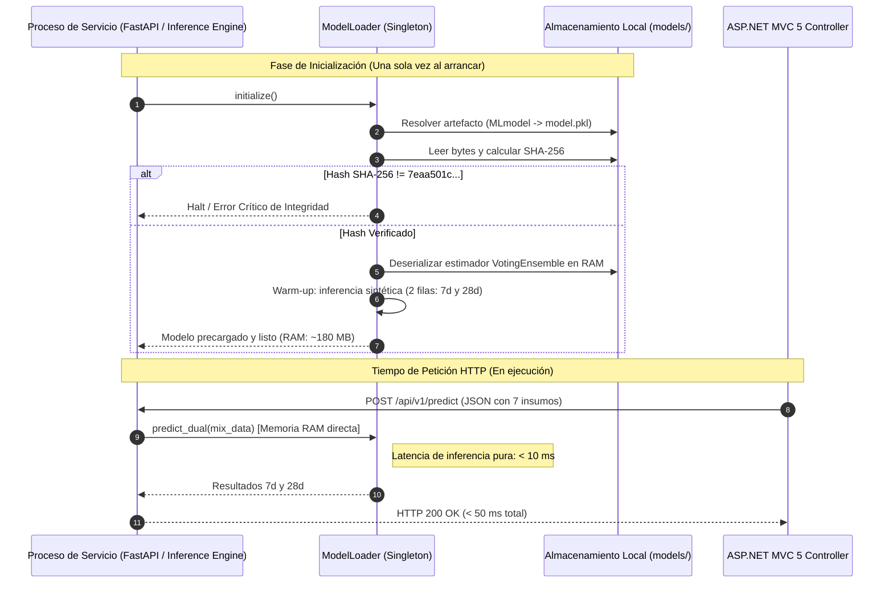
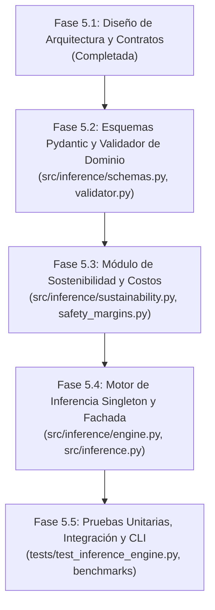

# Documento de Diseño Técnico — Fase 5.1: Motor de Inferencia EcoMix IA

**Proyecto:** EcoMix IA (`ecomix-ia-ml`)  
**Fase:** 5.1 — Especificación y Diseño del Motor de Inferencia  
**Línea Base Git:** [`2d3d75c48a7635dbb88b92987cbba4455a41f8c2`](https://github.com/JMedina255/EcoMix-IA-AzureML/commit/2d3d75c48a7635dbb88b92987cbba4455a41f8c2)  
**Rama de Trabajo:** `feat/phase-05-inference-service`  
**Consumidor Principal:** Plataforma Web ASP.NET MVC 5 (C#, Razor, Entity Framework 6, SQL Server)  
**Rol:** Arquitecto de Software y MLOps  
**Fecha:** 6 de Noviembre de 2026  

---

## 1. Contexto de Negocio y Visión de Integración

### 1.1 El Ecosistema EcoMix IA
EcoMix IA es una solución integral orientada a la descarbonización de la construcción (desarrollada en el marco del Reto 2 de Yura S.A.). El sistema permite dosificar concreto ecológico sustituyendo clínker/cemento Portland por materiales cementantes suplementarios (SCMs): **escoria de alto horno** y **ceniza volante / puzolana**, optimizando simultáneamente la resistencia a compresión ($f'_c$), el costo ($\text{S/./m}^3$) y la huella de carbono ($\text{kg CO}_2\text{e/m}^3$).

### 1.2 Interacción con la Aplicación ASP.NET MVC 5
La arquitectura general (documentada formalmente en FD02, FD03 y el Portal Archify 3.2 — Diagramas D02 y D03) desacopla físicamente la aplicación web monolítica del núcleo analítico de Machine Learning:

```mermaid
flowchart LR
    subgraph Frontend_Backend_Web["Plataforma Web (Monolito ASP.NET MVC 5)"]
        UI["Vistas Razor (Bootstrap 3/5)<br/>Formulario de Dosificación"]
        Controller["ConcreteMixController (C#)"]
        DB[("SQL Server (EF6)<br/>Dosificaciones y Ensayos")]
        UI -->|POST Form| Controller
        Controller -->|Persistencia| DB
    end

    subgraph ML_Inference_Service["Servicio de Inferencia EcoMix (Python / FastAPI)"]
        Validator["Validador de Entrada y Dominio UCI 165"]
        Engine["Motor de Inferencia Singleton<br/>VotingEnsemble MLflow"]
        Sustain["Calculador Analítico de Sostenibilidad<br/>(CO2 y Costos)"]
        Safety["Evaluador de Sobrediseño<br/>(ACI PRC-211.1-22 / 214R)"]
        
        Validator --> Engine
        Engine --> Sustain
        Sustain --> Safety
    end

    Controller -->|HTTP POST JSON (7 Insumos)| Validator
    Safety -->|HTTP 200 JSON (Dual 7d/28d + CO2 + Costos)| Controller
    Controller -->|Renderiza Gráficos y Dossier| UI
```

---

## 2. Análisis del Modelo y Dependencias del Runtime

### 2.1 Especificaciones Técnicas del Modelo Ganador
- **Nombre Canónico:** `VotingEnsemble` (Child Run: `wheat_cheese_4swj34tkjn_11`).
- **Activo Registrado (Model Asset):** `azureml_wheat_cheese_4swj34tkjn_11_output_mlflow_log_model_873731674:1`.
- **Hash Criptográfico (`model.pkl`):** `7eaa501c5eeb60135effb6b5861e736518ce969c47afd53727c2451083ff6388`.
- **Tamaño en Disco:** 670,849 bytes (~655.1 KB).
- **Rendimiento Independiente Certificado (Fase 4.4):**
  - Global ($n = 206$): $R^2 = \mathbf{0.9121}$, $\text{RMSE} = \mathbf{4.7592}\text{ MPa}$, $\text{MAE} = \mathbf{3.2822}\text{ MPa}$.
  - Sin solapamiento ($n = 195$): $R^2 = \mathbf{0.9174}$, $\text{RMSE} = \mathbf{4.5870}\text{ MPa}$.
  - Segmentado a 7 días ($n = 32$): $R^2 = \mathbf{0.8841}$, $\text{RMSE} = \mathbf{5.1725}\text{ MPa}$.
  - Segmentado a 28 días ($n = 75$): $R^2 = \mathbf{0.8235}$, $\text{RMSE} = \mathbf{5.5930}\text{ MPa}$.

### 2.2 Requisitos Estrictos de Runtime
De acuerdo con los metadatos de `MLmodel` y `conda.yaml`:
- **Python:** `3.10.19` (o runtime compatible Python 3.10.x).
- **Scikit-Learn:** `1.5.1`.
- **MLflow:** `2.15.1`.
- **Dependencia Crítica AutoML:** La clase estimadora base es `azureml.training.tabular.models.voting_ensemble.PreFittedSoftVotingRegressor`. Por lo tanto, el entorno de despliegue requiere `azureml-training-tabular` o un entorno virtual/contenedor alineado para deserialización fiel sin advertencias ni distorsiones numéricas.

---

## 3. Arquitectura Modular del Motor de Inferencia en Python

El motor de inferencia se estructurará bajo el principio de responsabilidad única (SRP), alta cohesión y bajo acoplamiento:

```text
src/
├── inference/
│   ├── __init__.py               # Fachada y exportación del motor
│   ├── config.py                 # Constantes, límites de dominio y rutas
│   ├── schemas.py                # Modelos Pydantic v2 (Request, Response, Errors)
│   ├── validator.py              # Validación de entradas, ratios y detección OOD
│   ├── model_loader.py           # Patrón Singleton con verificación de hash SHA-256
│   ├── engine.py                 # Orquestador de inferencia dual (7d y 28d)
│   ├── sustainability.py         # Cálculos analíticos de huella de carbono y costos
│   └── safety_margins.py         # Criterios de sobrediseño (ACI PRC-211.1-22 / 214R)
└── inference.py                  # Entrypoint CLI y fachada pública unificada
```

### 3.1 Desacoplamiento de Responsabilidades
1. **`model_loader.py` (Singleton & Warm Start):**  
   Garantiza que el modelo binario se cargue en memoria **una sola vez al iniciar el proceso**. Verifica el hash SHA-256 antes de admitir inferencias y ejecuta un *warm-up* sintético.
2. **`validator.py` (Integridad y Dominio):**  
   Verifica que los 7 insumos ingresados sean números válidos, no negativos y que se encuentren dentro del hipervolumen de entrenamiento (UCI 165). Calcula la relación agua/cementante ($a/c$ y $a/mc$).
3. **`engine.py` (Inferencia Dual):**  
   Construye las matrices NumPy para `age = 7` y `age = 28`, delegando la predicción en el pipeline en memoria.
4. **`sustainability.py` (Ecológico y Financiero):**  
   Aplica las ecuaciones maestras de FD02 y FD03 para cuantificar emisiones de $\text{CO}_2\text{e}$ y costos unitarios en Soles (S/.), contrastando contra mezclas patrón de referencia.
5. **`safety_margins.py` (Ingeniería Civil):**  
   Aplica el factor de sobrediseño sugerido para mitigar el RMSE observado de $5.59\text{ MPa}$ a 28 días.

---

## 4. Diseño del Contrato de Inferencia (Contratos JSON)

### 4.1 Principio de Diseño de Entrada
En las plantas de premezclado y obras civiles, el ingeniero ingresa la dosificación de insumos requerida para fabricar **un metro cúbico ($1\text{ m}^3$)** de concreto fresco. **No ingresa la variable `age` dos veces**; el motor de inferencia automáticamente expande la dosificación a las dos edades normativas: 7 días y 28 días.

### 4.2 Esquema JSON de Solicitud (Request Contract)

**Endpoint Futuro:** `POST /api/v1/predict/concrete-strength`

```json
{
  "$schema": "https://json-schema.org/draft/2020-12/schema",
  "mix_design": {
    "cement": 280.0,
    "blast_furnace_slag": 105.0,
    "fly_ash": 60.0,
    "water": 175.0,
    "superplasticizer": 8.5,
    "coarse_aggregate": 1020.0,
    "fine_aggregate": 750.0
  },
  "options": {
    "include_sustainability": true,
    "include_safety_margin": true,
    "custom_unit_costs": {
      "cement_pen_kg": 0.45,
      "slag_pen_kg": 0.22,
      "fly_ash_pen_kg": 0.18,
      "water_pen_kg": 0.005,
      "superplasticizer_pen_kg": 3.80,
      "coarse_agg_pen_kg": 0.045,
      "fine_agg_pen_kg": 0.040
    }
  }
}
```

### 4.3 Esquema JSON de Respuesta Exitosa (Response Contract - HTTP 200)

```json
{
  "status": "success",
  "predictions": {
    "strength_7d_mpa": 24.18,
    "strength_28d_mpa": 38.65,
    "recommended_design_strength_28d_mpa": 44.24,
    "safety_margin_applied_mpa": 5.59,
    "confidence_intervals": {
      "strength_7d_lower_95": 19.01,
      "strength_7d_upper_95": 29.35,
      "strength_28d_lower_95": 33.06,
      "strength_28d_upper_95": 44.24
    }
  },
  "mix_ratios": {
    "water_cement_ratio": 0.625,
    "water_binder_ratio": 0.393,
    "total_cementitious_content_kg_m3": 445.0,
    "scm_replacement_percentage": 37.08,
    "aggregates_total_kg_m3": 1770.0
  },
  "sustainability": {
    "embodied_carbon_kg_co2e_m3": 272.45,
    "reference_carbon_kg_co2e_m3": 405.00,
    "carbon_savings_kg_co2e_m3": 132.55,
    "carbon_savings_percentage": 32.73,
    "estimated_cost_pen_m3": 235.80,
    "reference_cost_pen_m3": 285.50,
    "cost_savings_pen_m3": 49.70,
    "cost_savings_percentage": 17.41
  },
  "warnings": [
    {
      "code": "WARN_HIGH_SCM_REPLACEMENT",
      "severity": "info",
      "message": "La sustitución de cemento por SCMs (37.08%) supera el 30%. Se recomienda verificar curado húmedo extendido para asegurar activación puzolánica."
    }
  ],
  "metadata": {
    "model_id": "wheat_cheese_4swj34tkjn_11",
    "model_type": "VotingEnsemble",
    "model_sha256": "7eaa501c5eeb60135effb6b5861e736518ce969c47afd53727c2451083ff6388",
    "inference_timestamp": "2026-11-06T15:20:00Z",
    "latency_ms": 8.42
  }
}
```

### 4.4 Esquema JSON de Errores de Validación (HTTP 422 - Unprocessable Entity)

En cumplimiento con el estándar **RFC 7807 (Problem Details)**:

```json
{
  "type": "https://ecomixia.yura.com.pe/errors/out-of-domain",
  "title": "Error de Validación de Dosificación",
  "status": 422,
  "detail": "Uno o más componentes exceden los límites físicos y experimentales de dosificación.",
  "instance": "/api/v1/predict/concrete-strength",
  "timestamp": "2026-11-06T15:22:10Z",
  "invalid_fields": [
    {
      "field": "mix_design.water",
      "value": 310.0,
      "constraint": "max_value",
      "limit": 247.0,
      "unit": "kg/m3",
      "message": "El contenido de agua (310.0 kg/m³) supera el límite máximo experimental (247.0 kg/m³). Provocaría segregación severa y pérdida drástica de resistencia."
    }
  ]
}
```

---

## 5. Estrategia de Carga y Validación del Modelo (Singleton & Warm Start)

Para cumplir con el requerimiento no funcional **N01 de ISO/IEC 25010** (latencia $< 2\text{ s}$ estipulada en FD03):



- **Inmutabilidad:** La instancia del estimador cargada en memoria es de solo lectura y *thread-safe* para llamadas concurrentes con NumPy.
- **Tolerancia a Desconexión de Azure:** La inferencia no realiza llamadas de red hacia Azure ML; utiliza los pesos congelados en disco.

---

## 6. Verificaciones de Rango y Detección de Dominio (Out-of-Domain - OOD)

El validador categoriza las restricciones en dos niveles:

### 6.1 Restricciones Duras (Rechazo con HTTP 422)
Insumos fuera de los límites absolutos del dataset UCI 165 o con proporciones físicamente inviables:

| Variable | Mínimo Permitido ($\text{kg/m}^3$) | Máximo Permitido ($\text{kg/m}^3$) | Justificación de Ingeniería |
| :--- | :---: | :---: | :--- |
| `cement` | $102.0$ | $540.0$ | Límite inferior para cohesión de pasta; superior evita figuración térmica. |
| `blast_furnace_slag` | $0.0$ | $359.4$ | Límite experimental máximo ensayado en laboratorio. |
| `fly_ash` | $0.0$ | $200.1$ | Límite experimental para puzolanas clase F / C. |
| `water` | $121.8$ | $247.0$ | Contenido de agua libre para hidratación y trabajabilidad. |
| `superplasticizer` | $0.0$ | $32.2$ | Dosis máxima admisible antes de retardo severo de fraguado. |
| `coarse_aggregate` | $801.0$ | $1145.0$ | Esqueleto granular grueso para soporte volumétrico. |
| `fine_aggregate` | $594.0$ | $992.6$ | Contenido de arena para empaquetamiento granular. |
| **Relación $a/mc$** | $\mathbf{0.25}$ | $\mathbf{0.70}$ | Relaciones fuera de este rango son físicamente defectuosas. |
| **Volumen Total** | $\approx 950\text{ dm}^3$ | $\approx 1050\text{ dm}^3$ | La suma de volúmenes absolutos debe aproximar a $1\text{ m}^3$ ($1000\text{ L}$). |

### 6.2 Restricciones Blandas (Advertencias Informativas en HTTP 200)
- **$a/mc > 0.55$:** *«Relación agua/cementante elevada para concreto estructural. Verifique requisitos de durabilidad para exposición a sulfatos (NTP 334.090 / ACI 318).»*
- **Sustitución $\text{SCM} > 45\%$:** *«Alto nivel de sustitución ecológica. Se anticipa desarrollo lento de resistencia a edades menores a 7 días.»*
- **`superplasticizer` $> 15\text{ kg/m}^3$ sin reducción de agua:** *«Dosis elevada de aditivo sin disminución proporcional de agua de mezclado. Riesgo potencial de exudación o segregación.»*

---

## 7. Modelado de Sostenibilidad y Costos (FD02 y FD03)

El módulo `sustainability.py` calcula el ahorro ambiental y económico sin alterar el pipeline predictivo:

### 7.1 Fórmulas Analíticas

#### Huella de Carbono del Concreto ($\text{kg CO}_2\text{e/m}^3$):
$$\text{CO}_2\text{e}_{\text{mezcla}} = \sum_{i=1}^{n} M_i \times EF_i$$

Donde $M_i$ es la masa del componente $i$ en $\text{kg/m}^3$ y $EF_i$ es su factor de emisión:
- Cemento Portland Tipo I: $EF_{\text{cemento}} = 0.860\text{ kg CO}_2\text{e/kg}$
- Escoria de alto horno (GGBFS): $EF_{\text{escoria}} = 0.082\text{ kg CO}_2\text{e/kg}$
- Ceniza volante / Puzolana: $EF_{\text{ceniza}} = 0.027\text{ kg CO}_2\text{e/kg}$
- Agua: $EF_{\text{agua}} = 0.0002\text{ kg CO}_2\text{e/kg}$
- Agregados (grueso y fino): $EF_{\text{agregados}} = 0.004\text{ kg CO}_2\text{e/kg}$
- Superplastificante: $EF_{\text{aditivo}} = 0.720\text{ kg CO}_2\text{e/kg}$

#### Ahorro Porcentual de Carbono:
$$\Delta\text{CO}_2\text{e} (\%) = \frac{\text{CO}_2\text{e}_{\text{ref}} - \text{CO}_2\text{e}_{\text{mezcla}}}{\text{CO}_2\text{e}_{\text{ref}}} \times 100$$
*(Donde la mezcla de referencia sustituye los SCMs por 100% Cemento Portland equivalente).*

---

## 8. Criterio de Sobrediseño y Márgenes de Seguridad (ACI PRC-211.1-22 / 214R)

Dado que la evaluación oficial certificó un RMSE a 28 días de **$5.59\text{ MPa}$**:
- **Riesgo:** Una mezcla diseñada para una resistencia nominal $f'_c = 30\text{ MPa}$ podría, debido a la dispersión experimental del modelo, entregar $25\text{ MPa}$.
- **Mitigación Arquitectónica:**  
  El servicio calcula la **resistencia promedio requerida ($f'_{cr}$)** inspirada en la filosofía de ACI 214R / ACI PRC-211.1-22:
  $$f'_{cr} = f'_c + k \cdot s$$
  Donde $s$ adopta el valor de $\text{RMSE}_{28d} = 5.59\text{ MPa}$ y $k = 1.0$ (margen de seguridad estándar para dosificación preliminar).
- La interfaz ASP.NET MVC 5 presentará tanto la resistencia estimada cruda como el valor de diseño recomendado con margen de seguridad.

---

## 9. Requisitos de Rendimiento, Seguridad y Despliegue en Azure

### 9.1 Rendimiento y SLAs
- **Tiempo de Inferencia Pura:** $< 15\text{ ms}$ en CPU mono-hilo.
- **Tiempo de Respuesta HTTP Total:** $< 80\text{ ms}$ (red local/VNet).
- **Consumo de Memoria:** $< 250\text{ MB}$ por worker en reposo; $< 350\text{ MB}$ en pico.

### 9.2 Seguridad y Autenticación para la API (Fase 6)
- **Autenticación por API Key (`X-EcoMix-API-Key`):** Token compartido entre ASP.NET MVC 5 y el microservicio FastAPI.
- **CORS Estricto:** Permitir únicamente peticiones originadas desde el dominio/IP del frontend ASP.NET MVC 5.
- **Sanitización de Errores:** Nunca exponer trazas de excepciones internas (*stack traces*) de Python hacia la aplicación cliente.

### 9.3 Estrategia de Hospedaje Económico en Azure

| Plataforma Azure | Tipo de Facturación | Escala a Cero ($0) | Idoneidad para EcoMix IA |
| :--- | :---: | :---: | :--- |
| **Azure Container Apps (ACA)** | **Serverless (por segundo)** | **Sí (0 instancias en inactividad)** | **RECOMENDADA (Óptima en costo y recursos para Hackathon).** |
| **Azure App Service (Linux B1)** | Costo Fijo (~$13 - $55 USD/mes) | No | Alternativa si se requiere IP estática dedicada sin cold-start. |
| **Azure ML Managed Endpoint** | Costo de VM continuo (~$150+ USD/mes) | No | **Descartada** por exceder presupuesto y recursos de prueba. |

---

## 10. Plan de Implementación Dividido en Tareas



1. **Tarea 5.2 (Esquemas y Validación):**  
   Implementar `schemas.py` y `validator.py` con tipado estricto, límites del dataset UCI 165 y detección de mezclas OOD.
2. **Tarea 5.3 (Sostenibilidad y Sobrediseño):**  
   Implementar `sustainability.py` y `safety_margins.py` con factores de emisión certificados y márgenes ACI.
3. **Tarea 5.4 (Motor Singleton):**  
   Implementar `model_loader.py` y `engine.py`, resolviendo la carga del `VotingEnsemble` verificado por hash SHA-256.
4. **Tarea 5.5 (Validación Integral):**  
   Crear suite exhaustiva de pruebas en `tests/test_inference_engine.py` (simulando peticiones de ASP.NET MVC 5, verificación de latencia, casos límites y advertencias).

---

## 11. Criterios de Aceptación de la Fase 5

- [ ] El motor debe predecir simultáneamente a 7 y 28 días en $< 20\text{ ms}$ sin deserializaciones repetidas.
- [ ] Para la dosificación canónica media de prueba, la predicción debe coincidir con el modelo de Azure ML dentro de una tolerancia numérica absoluta de $\pm 10^{-4}\text{ MPa}$.
- [ ] Toda dosificación con valores negativos o fuera de los límites de UCI 165 debe ser rechazada con código de validación estructurado.
- [ ] El cálculo de huella de carbono debe entregar valores determinísticos y consistentes con las ecuaciones analíticas de FD02/FD03.
- [ ] La suite de pruebas automatizadas debe alcanzar 100% de aprobación sin alterar modelos ni datasets existentes.
