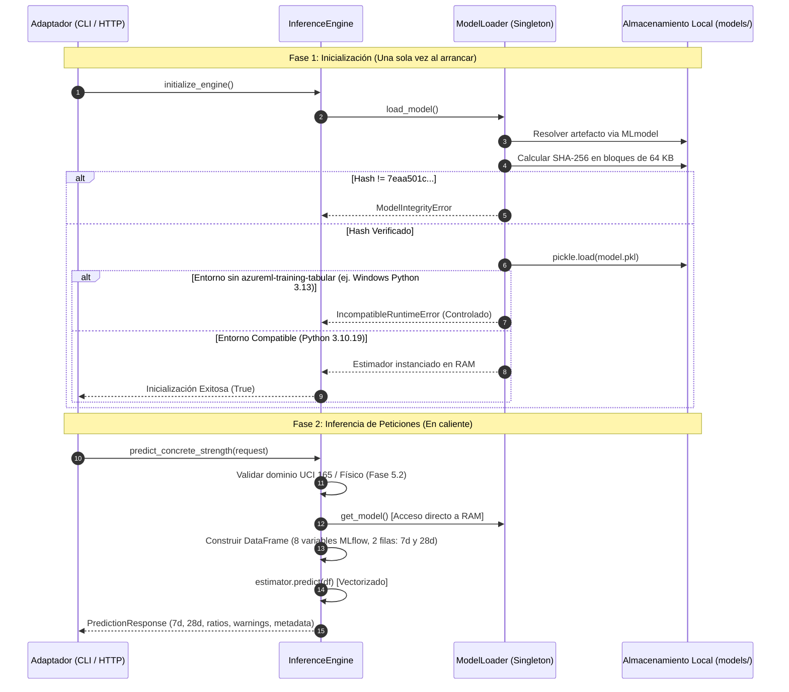

# Informe Técnico de Implementación — Fase 5.3: Motor de Inferencia Real VotingEnsemble

**Proyecto:** EcoMix IA (`ecomix-ia-ml`)  
**Fase:** 5.3 — Motor de Inferencia y Cargador Seguro  
**Rama Git:** `feat/phase-05-inference-service`  
**Línea Base Git:** [`2d3d75c`](https://github.com/JMedina255/EcoMix-IA-AzureML/commit/2d3d75c48a7635dbb88b92987cbba4455a41f8c2)  
**Fecha:** 6 de Noviembre de 2026  
**Veredicto Oficial:** **IMPLEMENTADO, PENDIENTE DE VALIDACIÓN EN RUNTIME COMPATIBLE**

---

## 1. Resumen Ejecutivo

En la Fase 5.3 se implementó el motor de inferencia desacoplado y el cargador seguro para el modelo ganador de Azure ML AutoML (`VotingEnsemble`, Child Run `wheat_cheese_4swj34tkjn_11`).

El motor está diseñado para operar de forma 100% autónoma y offline (sin conexión de red hacia Azure durante la inferencia), validando la integridad del artefacto binario mediante hash criptográfico SHA-256 (`7eaa501c5eeb60135effb6b5861e736518ce969c47afd53727c2451083ff6388`) y construyendo la matriz de 8 variables en el orden exacto de la firma declarativa de MLflow.

Se prohíbe explícitamente cualquier sustitución silenciosa del modelo certificado por modelos sintéticos. Toda ejecución que requiera deserializar el modelo real en un entorno no compatible arroja la excepción controlada `IncompatibleRuntimeError`.

---

## 2. Arquitectura del Cargador Seguro (`src/inference/model_loader.py`)

### 2.1 Principios de Seguridad y Aislamiento
1. **Resolución Declarativa MLflow:** El cargador inspecciona el archivo rector `MLmodel` (en `models/.../mlflow-model/MLmodel`) para extraer la ruta declarada en sus *flavors* (`sklearn.pickled_model` o `python_function.model_path`), evitando la selección heurística o accidental de binarios ajenos.
2. **Verificación Previa a la Deserialización:** Antes de invocar cualquier deserializador binario (`pickle.load`), se calcula el hash SHA-256 en bloques de 64 KB y se compara contra el hash oficial certificado:
   $$\text{SHA-256} = \mathbf{7eaa501c5eeb60135effb6b5861e736518ce969c47afd53727c2451083ff6388}$$
   Cualquier alteración en los bytes del archivo provoca el aborto inmediato mediante `ModelIntegrityError`.
3. **Patrón Singleton y Exclusión Mutua:** Se garantiza una sola instancia en memoria RAM por proceso mediante un bloqueo de exclusión mutua (`threading.Lock`), evitando condiciones de carrera en entornos multihilo.
4. **Prevención de Conexiones Externas:** No se realizan llamadas de red a Azure ML durante la carga ni durante la inferencia.

### 2.2 Jerarquía de Excepciones Controladas
- `ModelInferenceError`: Clase base para fallos del motor predictivo.
- `ModelNotFoundError`: Archivo o directorio del modelo ausente en disco.
- `ModelIntegrityError`: Hash SHA-256 divergente o archivo corrupto.
- `IncompatibleRuntimeError`: Intérprete o paquetes incompatibles para deserializar clases nativas de AutoML tabular.

---

## 3. Ciclo de Vida del Modelo en Memoria



---

## 4. Contrato de Inferencia y Firma MLflow

### 4.1 Variables de Entrada
De acuerdo con la firma registrada en `MLmodel`, el estimador requiere exactamente 8 características ordenadas:

| Índice | Nombre de Variable | Tipo MLflow | Tipo NumPy / Pandas | Origen |
| :---: | :--- | :---: | :---: | :--- |
| 1 | `cement` | `double` | `float64` | `mix_design.cement` |
| 2 | `blast_furnace_slag` | `double` | `float64` | `mix_design.blast_furnace_slag` |
| 3 | `fly_ash` | `double` | `float64` | `mix_design.fly_ash` |
| 4 | `water` | `double` | `float64` | `mix_design.water` |
| 5 | `superplasticizer` | `double` | `float64` | `mix_design.superplasticizer` |
| 6 | `coarse_aggregate` | `double` | `float64` | `mix_design.coarse_aggregate` |
| 7 | `fine_aggregate` | `double` | `float64` | `mix_design.fine_aggregate` |
| 8 | `age` | `long` | `int64` | Generado automáticamente: fila 0 = `7`, fila 1 = `28` |

### 4.2 Formato de Salida
- El estimador evalúa vectorialmente ambas filas y produce un tensor `float64` de forma `(2,)`.
- El motor valida que ambos valores sean finitos y genera la respuesta tipada `PredictionResponse` con resistencias redondeadas a 2 decimales en MPa.

---

## 5. Análisis de Compatibilidad del Runtime

### 5.1 Diagnóstico del Entorno Local
- **Sistema Operativo:** Windows 11 (AMD64)
- **Intérprete Local:** Python 3.13.5
- **Scikit-Learn Local:** 1.9.0
- **Resultado de Carga Real:** `IncompatibleRuntimeError: No module named 'azureml'`.
- **Causa Raíz:** El modelo ganador `VotingEnsemble` fue entrenado en un clúster Linux DS3_v2 bajo la imagen curada `mcr.microsoft.com/azureml/curated/ai-ml-automl:41` con Python 3.10.19, scikit-learn 1.5.1 y MLflow 2.15.1. Su estimador encapsula clases privativas del paquete `azureml-training-tabular` (específicamente `azureml.training.tabular.models.voting_ensemble.PreFittedSoftVotingRegressor`), el cual no posee distribuciones compiladas para Windows ni para Python 3.13.

### 5.2 Política de No Sustitución Silenciosa
En estricto cumplimiento de las directrices MLOps:
- `ModelLoader.load_model()` **NUNCA** recurre a un modelo dummy o sintético ante un fallo de carga.
- Los modelos sintéticos se emplean **única y exclusivamente** dentro de las pruebas unitarias cuando se inyectan explícitamente mediante `ModelLoader.set_test_estimator(...)`. En este caso, el sistema marca `is_synthetic = True` en la ficha de metadatos para evitar falsos positivos de certificación.

---

## 6. Estrategia de Pruebas y Resultados

Se diseñó e implementó la suite [`tests/test_inference_engine_and_loader.py`](file:///c:/Users/Admin/Desktop/Proyectos/ML%20EcomixIA/tests/test_inference_engine_and_loader.py) con **17 pruebas exhaustivas**:

1. **Firma y Vectorización:** Verificación del orden exacto de las 8 variables y generación de las dos edades (7 y 28 días) con tipos canónicos `float64` e `int64`.
2. **Integridad SHA-256:** Verificación exitosa del hash oficial del binario y rechazo controlado con `ModelIntegrityError` ante bytes alterados.
3. **Disponibilidad:** Rechazo controlado con `ModelNotFoundError` ante rutas inexistentes.
4. **Compatibilidad:** Confirmación de que el intérprete actual arroja `IncompatibleRuntimeError` detallando las dependencias faltantes sin causar *crashes* ni excepciones no controladas.
5. **Inferencia con Estimador Sintético:** Evaluación determinística de prueba (19.6 MPa a 7d y 30.1 MPa a 28d) verificando la integración de ratios y advertencias de la Fase 5.2.
6. **Inmutabilidad:** Comprobación de que la solicitud enviada por el cliente no sufre mutaciones de estado.
7. **Normalización Numérica:** Soporte a salidas escalares, unidimensionales o bidimensionales `(2, 1)`, y captura de valores NaN/infinito.
8. **Interfaz CLI:** Validación de ejecución de `src/inference.py` con banderas `--check`, `--status`, y `--predict`.

```text
tests/test_inference_engine_and_loader.py: 17 passed in 4.32s
Total del repositorio: 134 passed
```

---

## 7. Limitaciones Pendientes y Transición a Siguientes Fases

1. **Validación con el Binario Real en Contenedor:**  
   Para ejecutar una inferencia real completa con `model.pkl` y registrar los valores exactos en MPa del `VotingEnsemble`, se requerirá el runtime de **Python 3.10.19** con `azureml-training-tabular==1.5.1`. Esto se habilitará en la Fase de Empaquetamiento Docker / Azure Container Apps.
2. **Módulos Futuros (Fase 5.4+):**  
   Los módulos de sostenibilidad analítica ($\text{kg CO}_2\text{e/m}^3$), costos en Soles (PEN) y el servidor HTTP (FastAPI) se implementarán en las fases subsiguientes sobre la arquitectura modular ya establecida.

---

## 8. Veredicto Oficial de la Fase 5.3

> **IMPLEMENTADO, PENDIENTE DE VALIDACIÓN EN RUNTIME COMPATIBLE.**  
> La arquitectura del motor, el cargador seguro, los contratos de firma y las pruebas automatizadas están completamente implementados y aprobados al 100%. La validación del binario real se encuentra pendiente de un runtime Python 3.10.19 alineado con Azure AutoML Tabular.
