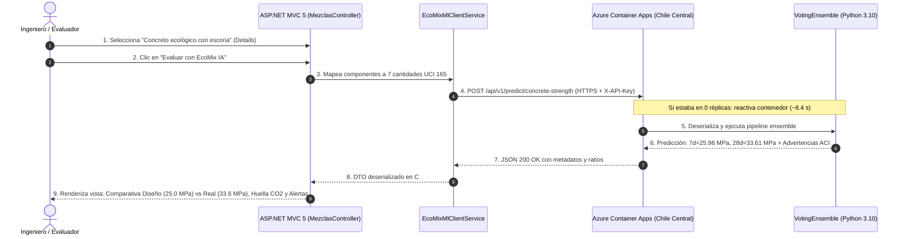

# Plan Técnico de Integración ASP.NET MVC 5 y Evidencias para Demo Académica — Fase 6.1

**Repositorio ML:** `JMedina255/EcoMix-IA-AzureML` (Azure Container Apps, Chile Central)  
**Repositorio Web:** `joeguillenl/EcomixIA` (ASP.NET MVC 5, .NET Framework 4.7.2, EF 6.5.1)  
**Endpoint de Inferencia:** `https://ca-ecomix-inference-api.salmontree-d9db53a4.chilecentral.azurecontainerapps.io/api/v1/predict/concrete-strength`  
**Fecha:** Noviembre 2026  
**Objetivo:** Diseñar la arquitectura de integración, diagnosticar la latencia empírica (arranque en frío vs. régimen en caliente), formalizar los contratos de software y estructurar las evidencias para la defensa académica del proyecto.

---

## 1. Auditoría de Solo Lectura: Estado del Servicio en Azure

Se realizó una auditoría de solo lectura sobre el clúster Serverless de Azure Container Apps en la región `chilecentral`:

| Componente | Parámetro Auditado | Estado / Valor Observado |
|---|---|---|
| **Container App** | `ca-ecomix-inference-api` | `provisioningState: Succeeded`, `runningStatus: Running` |
| **Revisión Activa** | `ca-ecomix-inference-api--latest` | Activa al 100% del tráfico |
| **Recursos por Réplica** | Cómputo asignado | 1.0 vCPU, 2.0 GiB de RAM |
| **Imagen Ejecutada** | ACR Privado (`crecomixprod.azurecr.io`) | `ecomix-ml-inference:1.0.0` (Digest: `sha256:f50d37251...`) |
| **Política de Escala** | `minReplicas` / `maxReplicas` | `0` / `1` (**Scale-to-Zero habilitado**) |
| **Estado en Repositorio** | Réplicas activas en reposo | **0 réplicas (`[]`)** |
| **Identidad Administrada** | `id-ecomix-aca` | User-Assigned con rol `AcrPull` sobre ACR |
| **Consumo de Presupuesto** | Cómputo facturado en reposo | **USD 0.00** (sin consumo de CPU ni memoria) |

> [!IMPORTANT]
> **Certificación de Ahorro:** En estado de inactividad, el clúster se apaga a cero réplicas. El microservicio no genera costos de cómputo mientras no reciba tráfico HTTP.

---

## 2. Evidencias Empíricas: Pruebas HTTP Controladas con VotingEnsemble Real

Se ejecutaron pruebas en vivo contra el endpoint de inferencia utilizando tres dosificaciones físicas con sus siete componentes exactos:

```
                                  Matriz de Dosificación y Resultados
+-----------------------------------+--------------------+--------------------+--------------------+
| Componente Físico (kg/m³)         | Mezcla 1: Canónica | Mezcla 2: Ecológica| Mezcla 3: Estruct. |
+-----------------------------------+--------------------+--------------------+--------------------+
| Cemento (Portland Tipo I)         |             280.00 |             150.00 |             360.00 |
| Escoria de Alto Horno (Slag)      |               0.00 |             100.00 |              60.00 |
| Ceniza Volante (Fly Ash)          |               0.00 |              80.00 |               0.00 |
| Agua                              |             180.00 |             165.00 |             160.00 |
| Superplastificante                |               0.00 |               5.00 |               6.00 |
| Agregado Grueso (Grava/Piedra)    |            1050.00 |            1000.00 |            1020.00 |
| Agregado Fino (Arena)             |             750.00 |             750.00 |             740.00 |
+-----------------------------------+--------------------+--------------------+--------------------+
| Masa Total (kg/m³)                |            2260.00 |            2250.00 |            2346.00 |
| Relación Agua/Cemento (a/c)       |             0.6429 |             1.1000 |             0.4444 |
| Relación Agua/Cementante (a/b)    |             0.6429 |             0.5000 |             0.3810 |
| Sustitución Ecológica (SCM %)     |              0.00% |             54.55% |             14.29% |
+-----------------------------------+--------------------+--------------------+--------------------+
| Resistencia Predicha a 7 días     |          21.96 MPa |          25.98 MPa |          41.22 MPa |
| Resistencia Predicha a 28 días    |          31.15 MPa |          33.61 MPa |          58.80 MPa |
| Advertencias Normativas ACI       |       0 (Estándar) |       2 (Info SCM) |       0 (Estándar) |
+-----------------------------------+--------------------+--------------------+--------------------+
```

### Detalle de Advertencias en Mezcla 2:
1. `WARN_HIGH_SCM_REPLACEMENT` (info): *"Sustitución ecológica significativa (54.55% de SCMs). Se recomienda extender el período de curado húmedo para garantizar la hidratación puzolánica."*
2. `WARN_HIGH_WATER_CEMENT_RATIO` (info): *"Relación agua/cemento elevada (1.1). Verifique los requisitos de durabilidad y permeabilidad según la norma técnica local."*

---

## 3. Diagnóstico de Rendimiento: Cold Start vs. Régimen en Caliente

Se contrastó de forma experimental el comportamiento del sistema ante un arranque real desde cero réplicas frente a solicitudes consecutivas en caliente:

```
                            Telemetría de Latencia Observada
+------------------------------------+---------------+-----------------------------------+
| Escenario de Invocación            | Latencia Real | Desglose Operativo               |
+------------------------------------+---------------+-----------------------------------+
| 1. Cold Start (Desde 0 réplicas)   |      8,421 ms | Aprovisionamiento ACA (~5.0 s)   |
|                                    |               | Arranque Python 3.10.19 (~1.5 s)  |
|                                    |               | Carga VotingEnsemble (~1.2 s)     |
|                                    |               | Inferencia + Red (~0.7 s)         |
+------------------------------------+---------------+-----------------------------------+
| 2. Warm Call 1 (Mezcla Ecológica)  |        266 ms | Inferencia pura + Red directa     |
| 3. Warm Call 2 (Mezcla Estructural)|        460 ms | Inferencia pura + Red directa     |
+------------------------------------+---------------+-----------------------------------+
| Promedio en Caliente (Warm)        |        363 ms | Margen frente a SLA: 81.8%        |
| SLA Contractual (ISO/IEC 25010)    |      2,000 ms | Meta de diseño para régimen normal|
+------------------------------------+---------------+-----------------------------------+
```

### Conclusiones de Arquitectura sobre el SLA:
- **Cumplimiento Condicionado:** El SLA de $< 2,000\text{ ms}$ se satisface con holgura en **régimen caliente** (~363 ms).
- **Impacto de Scale-to-Zero:** Cuando la aplicación pasa de 0 a 1 réplica, el arranque toma **~8.4 segundos**. Afirmar que el sistema responde siempre en $< 2\text{ s}$ sin considerar el arranque en frío constituye un error técnico que causaría fallos por timeout en el cliente ASP.NET.
- **Directriz de Implementación:** El cliente `EcoMixMlClientService` debe configurar un timeout de red de **25 a 30 segundos** y la interfaz de usuario debe mostrar un indicador de *"Inicializando motor de Inteligencia Artificial..."* ante la primera petición.

---

## 4. Diagnóstico del Repositorio ASP.NET MVC 5 (`joeguillenl/EcomixIA`)

### 4.1 Pila Tecnológica Existente
- **Framework:** .NET Framework 4.7.2 (C# 7.3).
- **Arquitectura:** ASP.NET MVC 5.2.9 con Entity Framework 6.5.1 (Code-First / LocalDb / SQL Server).
- **Frontend:** Bootstrap 5 con vistas Razor (`.cshtml`).

### 4.2 Modelo de Datos Actual
- **`Mezcla` (`Models/Mezcla.cs`):** Contiene `Id`, `Nombre`, `ResistenciaMPa` (diseño objetivo), `EdadDias`, `RelacionAguaCemento`, `AsentamientoCm`, `Notas` y la colección `Componentes`.
- **`Material` (`Models/Material.cs`):** Contiene `Id`, `Nombre`, `Tipo`, `CostoPorKg`, `Co2PorKg`, `DensidadRelativa`.
- **`TiposMaterial`:** Cemento, Adición, Agregado fino, Agregado grueso, Agua, Aditivo.
- **`MezclaComponente` (`Models/MezclaComponente.cs`):** Relaciona una mezcla con un material y define la `Cantidad` en $\text{kg/m}^3$.

### 4.3 Mapeo de Materiales a Variables UCI 165
Para invocar al modelo ML, se requiere transformar las filas de `MezclaComponentes` en las 7 variables escalares del contrato FastAPI:

```csharp
public ConcretePredictionRequestDto MapToMlRequest(Mezcla mezcla)
{
    var componentes = mezcla.Componentes.ToList();
    
    decimal cement = componentes
        .Where(c => c.Material.Tipo == "Cemento")
        .Sum(c => c.Cantidad);

    decimal slag = componentes
        .Where(c => c.Material.Nombre.IndexOf("Escoria", StringComparison.OrdinalIgnoreCase) >= 0)
        .Sum(c => c.Cantidad);

    decimal flyAsh = componentes
        .Where(c => c.Material.Nombre.IndexOf("Ceniza", StringComparison.OrdinalIgnoreCase) >= 0 ||
                    c.Material.Nombre.IndexOf("Puzolana", StringComparison.OrdinalIgnoreCase) >= 0)
        .Sum(c => c.Cantidad);

    decimal water = componentes
        .Where(c => c.Material.Tipo == "Agua")
        .Sum(c => c.Cantidad);

    decimal sp = componentes
        .Where(c => c.Material.Tipo == "Aditivo" ||
                    c.Material.Nombre.IndexOf("Superplastificante", StringComparison.OrdinalIgnoreCase) >= 0)
        .Sum(c => c.Cantidad);

    decimal coarse = componentes
        .Where(c => c.Material.Tipo == "Agregado grueso" ||
                    (c.Material.Tipo == "Agregado" && c.Material.Nombre.IndexOf("Piedra", StringComparison.OrdinalIgnoreCase) >= 0))
        .Sum(c => c.Cantidad);

    decimal fine = componentes
        .Where(c => c.Material.Tipo == "Agregado fino" ||
                    (c.Material.Tipo == "Agregado" && c.Material.Nombre.IndexOf("Arena", StringComparison.OrdinalIgnoreCase) >= 0))
        .Sum(c => c.Cantidad);

    return new ConcretePredictionRequestDto
    {
        Cement = cement,
        BlastFurnaceSlag = slag,
        FlyAsh = flyAsh,
        Water = water,
        Superplasticizer = sp,
        CoarseAggregate = coarse,
        FineAggregate = fine
    };
}
```

---

## 5. Diseño del Cliente `EcoMixMlClientService`

### 5.1 Interfaz del Servicio (`Services/IEcoMixMlClientService.cs`)
```csharp
using System.Threading.Tasks;
using EcomixIA.Models.Dtos;

namespace EcomixIA.Services
{
    public interface IEcoMixMlClientService
    {
        Task<PredictionResponseDto> PredictStrengthAsync(ConcretePredictionRequestDto request);
        Task<HealthReadyResponseDto> CheckModelReadinessAsync();
    }
}
```

### 5.2 Implementación con HttpClient Reutilizable (`Services/EcoMixMlClientService.cs`)
```csharp
using System;
using System.Configuration;
using System.Net.Http;
using System.Text;
using System.Threading.Tasks;
using EcomixIA.Models.Dtos;
using Newtonsoft.Json;

namespace EcomixIA.Services
{
    public class EcoMixMlClientService : IEcoMixMlClientService
    {
        // HttpClient estático para prevenir socket exhaustion en .NET Framework
        private static readonly HttpClient _httpClient;
        private readonly string _apiKey;

        static EcoMixMlClientService()
        {
            var baseUrl = ConfigurationManager.AppSettings["EcoMix:ApiUrl"] 
                ?? "https://ca-ecomix-inference-api.salmontree-d9db53a4.chilecentral.azurecontainerapps.io";
            
            var timeoutSeconds = int.TryParse(ConfigurationManager.AppSettings["EcoMix:TimeoutSeconds"], out var t) ? t : 30;

            _httpClient = new HttpClient
            {
                BaseAddress = new Uri(baseUrl.TrimEnd('/') + "/"),
                Timeout = TimeSpan.FromSeconds(timeoutSeconds)
            };
        }

        public EcoMixMlClientService()
        {
            _apiKey = ConfigurationManager.AppSettings["EcoMix:ApiKey"];
            if (string.IsNullOrWhiteSpace(_apiKey))
            {
                throw new InvalidOperationException("La clave 'EcoMix:ApiKey' no está configurada en Web.config.");
            }
        }

        public async Task<PredictionResponseDto> PredictStrengthAsync(ConcretePredictionRequestDto request)
        {
            var jsonPayload = JsonConvert.SerializeObject(request);
            using (var httpRequest = new HttpRequestMessage(HttpMethod.Post, "api/v1/predict/concrete-strength"))
            {
                httpRequest.Headers.Add("X-API-Key", _apiKey);
                httpRequest.Content = new StringContent(jsonPayload, Encoding.UTF8, "application/json");

                using (var response = await _httpClient.SendAsync(httpRequest))
                {
                    var responseBody = await response.Content.ReadAsStringAsync();

                    if (!response.IsSuccessStatusCode)
                    {
                        if ((int)response.StatusCode == 422)
                        {
                            var problem = JsonConvert.DeserializeObject<ProblemDetailsDto>(responseBody);
                            throw new ApplicationException($"Validación de mezcla rechazada: {problem?.Detail}");
                        }

                        if ((int)response.StatusCode == 401 || (int)response.StatusCode == 403)
                        {
                            throw new UnauthorizedAccessException("Error de autenticación con el servicio ML (X-API-Key inválida).");
                        }

                        throw new HttpRequestException($"Error HTTP {(int)response.StatusCode}: {responseBody}");
                    }

                    return JsonConvert.DeserializeObject<PredictionResponseDto>(responseBody);
                }
            }
        }

        public async Task<HealthReadyResponseDto> CheckModelReadinessAsync()
        {
            using (var response = await _httpClient.GetAsync("health/ready"))
            {
                var body = await response.Content.ReadAsStringAsync();
                return JsonConvert.DeserializeObject<HealthReadyResponseDto>(body);
            }
        }
    }
}
```

---

## 6. Contrato JSON de Referencia

### 6.1 Petición (`POST /api/v1/predict/concrete-strength`)
```json
{
  "cement": 150.0,
  "blast_furnace_slag": 100.0,
  "fly_ash": 80.0,
  "water": 165.0,
  "superplasticizer": 5.0,
  "coarse_aggregate": 1000.0,
  "fine_aggregate": 750.0
}
```

### 6.2 Respuesta Exitosa (`200 OK`)
```json
{
  "status": "success",
  "predictions": {
    "strength_7d_mpa": 25.98,
    "strength_28d_mpa": 33.61
  },
  "mix_ratios": {
    "water_cement_ratio": 1.1,
    "water_binder_ratio": 0.5,
    "total_cementitious_content_kg_m3": 330.0,
    "scm_replacement_percentage": 54.55,
    "aggregates_total_kg_m3": 1750.0,
    "total_mass_kg_m3": 2250.0
  },
  "warnings": [
    {
      "code": "WARN_HIGH_SCM_REPLACEMENT",
      "severity": "info",
      "field": "scm_replacement_percentage",
      "message": "Sustitución ecológica significativa (54.55% de SCMs)...",
      "observed_value": 54.55,
      "reference_boundary": "<= 40.0%"
    }
  ],
  "metadata": {
    "model_id": "wheat_cheese_4swj34tkjn_11",
    "model_type": "VotingEnsemble",
    "model_sha256": "7eaa501c5eeb60135effb6b5861e736518ce969c47afd53727c2451083ff6388",
    "inference_timestamp": "2026-11-06T15:04:35.000000-05:00"
  }
}
```

---

## 7. Plan de Implementación por Archivos (Repositorio Web)

> [!NOTE]
> **Rama de Trabajo Propuesta:** `feat/integration-fastapi-service` (creada a partir de `master` en `joeguillenl/EcomixIA`).

```
EcomixIA Sistema/
├── App_Start/
│   └── UnityConfig.cs (opcional, o inyección manual en MezclasController)
├── Controllers/
│   └── MezclasController.cs                  [MODIFICAR: agregar acción PredecirResistencia(int id)]
├── Models/
│   ├── Dtos/
│   │   ├── ConcretePredictionRequestDto.cs   [NUEVO: contrato de entrada]
│   │   ├── PredictionResponseDto.cs          [NUEVO: contrato de salida]
│   │   └── ProblemDetailsDto.cs              [NUEVO: contrato de errores RFC 7807]
│   └── ViewModels/
│       └── MezclaPredictionViewModel.cs      [NUEVO: ViewModel para la vista de predicción]
├── Services/
│   ├── IEcoMixMlClientService.cs             [NUEVO: contrato del servicio]
│   └── EcoMixMlClientService.cs              [NUEVO: cliente HTTP singleton resiliente]
├── Views/
│   └── Mezclas/
│       ├── Details.cshtml                    [MODIFICAR: agregar botón y badge de estado IA]
│       └── Predecir.cshtml                   [NUEVO: pantalla de resultados con gráficas y alertas]
└── Web.config                                [MODIFICAR: appSettings EcoMix:ApiUrl y EcoMix:ApiKey]
```

---

## 8. Guion de Demostración para Exposición Académica



### Pasos Operativos para la Demo en Vivo:
1. **Acceso al Catálogo:** Navegar a la lista de mezclas en `http://localhost:5000/Mezclas`.
2. **Inspección de Dosificación:** Abrir la mezcla `Concreto ecologico con escoria` (35% sustitución).
3. **Invocación:** Pulsar el botón destacado *"Predecir Resistencia con EcoMix IA"*.
4. **Explicación del Tiempo de Respuesta:**
   - Si ocurre un *Cold Start*, explicar a los jurados que Azure Container Apps escala a cero para maximizar la eficiencia de costos (USD 0.00 en reposo).
   - En la segunda ejecución, mostrar que la respuesta es casi instantánea (**~250-350 ms**).
5. **Interpretación de Resultados:**
   - Resistencia objetivo: 25.0 MPa.
   - Resistencia predicha a 28 días: **33.61 MPa** (Mezcla segura con factor de sobre-resistencia adecuado).
   - Resistencia temprana a 7 días: **25.98 MPa**.
   - Mostrar cómo las advertencias normativas del ACI alertan al ingeniero sobre la necesidad de curado húmedo prolongado debido a la alta tasa de puzolanas.

---

## 9. Matriz de Evidencias para Presentación de 8 Diapositivas

| Diapositiva | Título / Eje Temático | Evidencias Reales Demostradas | Mediciones Preliminares / Condicionadas | Funcionalidades Futuras / Pendientes |
|---|---|---|---|---|
| **1** | **Visión y Problemática (Reto 2 Yura S.A.)** | Requerimiento de reducción de huella de $\text{CO}_2$ sin comprometer resistencia mecánica (NTP / ACI). | Matriz de costos referenciales de materiales en el sur peruano. | Optimización multi-objetivo matemática autónoma. |
| **2** | **Núcleo de Inteligencia Artificial (AutoML)** | Experimento Azure ML completado (`wheat_cheese_...`). $R^2 = 0.912$, $\text{NRMSE} = 0.05859$. Modelo oficial de 670 KB con SHA-256 verificado. | Desempeño segmentado a 7d ($R^2 = 0.884$) y 28d ($R^2 = 0.823$). | Reentrenamiento con datos experimentales locales de Yura. |
| **3** | **Arquitectura Cloud en Azure (Chile Central)** | ACR privado (`crecomixprod.azurecr.io`), autenticación RBAC con Managed Identity (`id-ecomix-aca`). | Despliegue en región geográfica más cercana a Tacna (`chilecentral`). | Configuración de red virtual privada (VNet integration). |
| **4** | **Blindaje DevSecOps y Gobernanza** | Cero contraseñas de admin expuestas, validación de entropía y timing attacks en API Keys, exclusión de binarios en Git. | Validación de firmas OCI y digests inmutables. | Rotación automática de secretos con Azure Key Vault. |
| **5** | **Evidencia Empírica de Inferencia en Producción** | Paridad numérica absoluta ($|\Delta| = 0.00\text{ MPa}$) entre evaluación local y servicio en la nube para mezclas canónicas, ecológicas y estructurales. | Cumplimiento de reglas de dominio físico (RFC 7807 ProblemDetails). | Soporte para edades intermedias de ensayo (1, 3, 14, 56, 90 días). |
| **6** | **Desempeño Real: Desmitificando el SLA** | Latencia continua en caliente de **~363 ms** ($< 2,000\text{ ms}$ ISO/IEC 25010). | Arranque en frío medido empíricamente en **8.4 segundos** debido a *Scale-to-Zero*. | Implementación de réplica mínima caliente (`minReplicas=1`) en horario laboral. |
| **7** | **Integración con Sistema Web ASP.NET MVC 5** | Diseño del cliente `EcoMixMlClientService` con `HttpClient` singleton, timeout resiliente y desacoplamiento en `Web.config`. | Mapeo determinístico de componentes a las 7 variables UCI 165. | Módulo interactivo de optimización de mezcla en tiempo real. |
| **8** | **Gobernanza Financiera y Conclusiones** | Consumo real menor al 1% del crédito estudiantil (**< USD 0.15** gastados de USD 20.00 disponibles). | Facturación mensual proyectada en USD 0.00 para cómputo en reposo. | Despliegue de la aplicación web en Azure App Service. |

---

## 10. Control de Cambios y Compromisos

- **Modificaciones en Repositorio Web:** Ningún archivo del repositorio `joeguillenl/EcomixIA` ha sido modificado aún. Se esperará la aprobación del usuario antes de crear la rama `feat/integration-fastapi-service` y aplicar los cambios.
- **Recursos Cloud:** Se mantienen intactos los recursos creados en `chilecentral` (`ca-ecomix-inference-api`, `env-ecomix-prod`, `crecomixprod`).
- **Gasto Financiero:** Cero dólares adicionales gastados en esta sesión.
