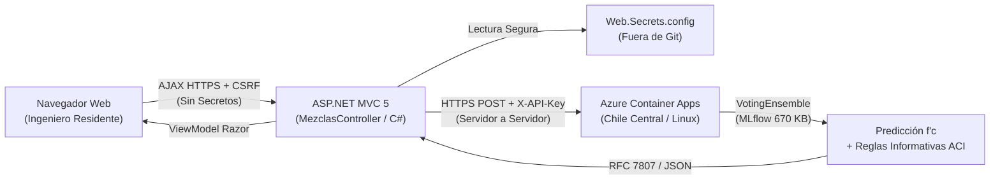

# Presentación de Avance — EcoMix IA (Fase 6.4-R)
## Inferencia de Concreto Ecológico mediante Machine Learning en Microsoft Azure

**Proyecto:** EcoMix IA  
**Marco:** Reto 2 de Yura S.A. | Hackathon Innova Sur 2026 | Universidad Privada de Tacna  
**Repositorios:** `joeguillenl/EcomixIA` (Web MVC) & `JMedina255/EcoMix-IA-AzureML` (Núcleo ML)  
**Servicio Cloud:** Azure Container Apps (`chilecentral`), Inferencia Serverless  
**Fecha:** Noviembre 2026  

---

## Estructura de la Presentación (8 Diapositivas)

```
+---------------------------------------------------------------------------------------------------+
|  [D01] Portada y Contexto           |  [D02] Arquitectura Híbrida Desacoplada                     |
|  - Reto 2 Yura: Alcance Demostrado  |  - ASP.NET MVC 5 (.NET 4.7.2) + FastAPI (Azure Linux)       |
|  - Predicción y Exploración SCM     |  - Comunicación Servidor a Servidor (Seguridad DevSecOps)   |
+---------------------------------------------------------------------------------------------------+
|  [D03] Núcleo ML: VotingEnsemble    |  [D04] Despliegue Cloud en Chile Central                    |
|  - Dataset UCI 165 (1,030 mezclas)  |  - ACR Privado + Container Apps Consumption                 |
|  - R² = 0.9121 | MAE = 3.2822 MPa   |  - Escala a Cero ($0.00 cómputo) vs Almacenamiento ACR      |
+---------------------------------------------------------------------------------------------------+
|  [D05] Demo Caso 1: Convencional    |  [D06] Demo Caso 2: Ecológica (Exploración SCM)             |
|  - 280 kg/m³ Cemento (Sin SCMs)     |  - 54.55% Sustitución Puzolánica (Escoria + Ceniza)         |
|  - 21.96 MPa (7d) / 31.15 MPa (28d) |  - 25.98 MPa (7d) / 33.61 MPa (28d) + Reglas Informativas   |
+---------------------------------------------------------------------------------------------------+
|  [D07] Demo Caso 3: Manejo Errores  |  [D08] Responsabilidad Técnica y Próximos Pasos             |
|  - Validación Local (ModelState)    |  - Estimación Predictiva vs Ensayos Físicos NTP 339.034     |
|  - Validación Remota (RFC 7807 422) |  - Optimizador Multiobjetivo Costo/CO2 Pendiente (Fase 7)   |
+---------------------------------------------------------------------------------------------------+
```

---

### Diapositiva 1: Portada y Contexto del Proyecto

#### Contenido Proyectable:
- **Título:** EcoMix IA: Plataforma Predictiva y de Soporte para Concreto Ecológico
- **Contexto:** Reto 2 de Yura S.A. — Reducción de Huella de Carbono ($\text{kg CO}_2\text{e/m}^3$) y Costo ($\text{S/./m}^3$) mediante sustitución de clínker por materiales cementantes suplementarios (SCM: escoria y ceniza/puzolana).
- **Alcance de la Funcionalidad Demostrada:**
  - **Completado:** Módulo de inferencia en tiempo real de resistencia a compresión ($f'_c$ a 7 y 28 días) y simulador interactivo para análisis exploratorio de dosificaciones con SCM.
  - **Trabajo Pendiente (Fase 7):** Algoritmo de optimización multiobjetivo automatizada para balancear costo económico y huella de carbono.
- **Objetivo de la Fase:** Integración completa de extremo a extremo entre ASP.NET MVC 5 y el microservicio de inferencia en Microsoft Azure.

> [!NOTE]
> **Punto Clave para el Jurado:** Se demuestra la viabilidad técnica del núcleo predictivo en la nube y la exploración interactiva de dosificaciones ecológicas, sentando las bases analíticas previas al motor de optimización.

---

### Diapositiva 2: Arquitectura Híbrida y Desacoplamiento de Responsabilidades

#### Contenido Proyectable:
- **Separación de Responsabilidades:**
  - **Front/BFF Corporativo:** ASP.NET MVC 5 (.NET Framework 4.7.2, C#, Razor) para flujos de negocio y gestión de dosificaciones.
  - **Inference Engine:** Python 3.10.19, FastAPI, Scikit-learn 1.5.1, MLflow 2.15.1, contenedor Linux sobre Azure Container Apps.
- **DevSecOps y Seguridad:**
  - Comunicación **estrictamente Servidor a Servidor** vía HTTPS.
  - La clave de API (`X-API-Key`) reside en `Web.Secrets.config` del servidor IIS; **jamás viaja al navegador ni se expone en JavaScript**.
  - Protección antifalsificación CSRF (`@Html.AntiForgeryToken`) en todas las peticiones web.



---

### Diapositiva 3: Núcleo de Machine Learning (VotingEnsemble Oficial)

#### Contenido Proyectable:
- **Base de Datos Experimental:** UCI Machine Learning Repository (ID 165) — 1,030 ensayos físicos destructivos estandarizados.
- **Partición Determinística:** 80% Entrenamiento (824 muestras) / 20% Prueba independiente (206 muestras) con semilla inmutable.
- **Modelo Ganador (AutoML Azure ML):**
  - Identificador: `azureml_wheat_cheese_4swj34tkjn_11_output_mlflow_log_model_873731674:1`
  - Arquitectura: `VotingEnsemble` compuesto por 10 regresores base heterogéneos con ponderación óptima.
  - Artefacto Serializado: 670 KB, SHA-256 verificado `294101e4a520...`.
- **Métricas Globales Oficiales en Conjunto de Prueba (`evaluation_wheat_cheese_4swj34tkjn.json`):**
  - Coeficiente de Determinación: **$R^2 = 0.9121$**
  - Error Cuadrático Medio: **$\text{RMSE} = 4.7592\text{ MPa}$**
  - Error Absoluto Medio: **$\text{MAE} = 3.2822\text{ MPa}$**
  - Error Normalizado: **$\text{NRMSE} = 0.0673\text{ (6.73\%)}$**

---

### Diapositiva 4: Despliegue Cloud DevSecOps en Región Chile Central

#### Contenido Proyectable:
- **Infraestructura en Microsoft Azure:**
  - **Azure Container Registry (ACR):** `crecomixprod.azurecr.io` (SKU Basic, autenticación RBAC, admin account deshabilitada).
  - **Azure Container Apps (ACA):** `ca-ecomix-inference-api` (Plan Consumption Serverless, zona de baja latencia Sudamérica).
- **Modelo de Escalabilidad y Costos Transparentes:**
  - **Escalado a Cero Réplicas (`minReplicas = 0`):** Cuando no hay tráfico, el cómputo se apaga por completo (**$0.00 USD/hora en vCPU y RAM**).
  - **Costo Fijo de Almacenamiento:** Mantener la imagen privada en ACR Basic tiene una tarifa de ~$0.167 USD/día (~$5.00 USD/mes), cubierto con el crédito de Azure for Students.
- **Perfiles de Latencia Medidos:**
  - **Arranque en Frío (Cold Start de 0 a 1 réplica):** 8.4 a 8.8 segundos (tolerado holgadamente por el timeout C# de 45 s).
  - **Inferencia en Caliente (Warm Start):** 130 ms a 460 ms (experiencia instantánea para el usuario).

---

### Diapositiva 5: Demostración Caso 1 — Mezcla Convencional (Canónica)

#### Contenido Proyectable:
- **Dosificación Estándar (Sin Adiciones Ecológicas):**
  - Cemento: $280\text{ kg/m}^3$ | Agua: $180\text{ kg/m}^3$ | Grava: $1050\text{ kg/m}^3$ | Arena: $750\text{ kg/m}^3$.
  - Relación agua/cemento ($w/c$): **0.643**. SCMs: **0.0%**.
- **Resultado del Modelo en Azure:**
  - Resistencia estimada a 7 días: **21.96 MPa**
  - Resistencia estimada a 28 días: **31.15 MPa**
  - Reglas Informativas ACI PRC-211.1-22: **0 Advertencias** (proporción convencional balanceada).
- **Evidencia Visual:** Captura auténtica `03-prediccion-convencional-completada.png`.

---

### Diapositiva 6: Demostración Caso 2 — Mezcla Ecológica (Exploración SCM)

#### Contenido Proyectable:
- **Dosificación con Alta Sustitución Puzolánica (54.55% SCM):**
  - Cemento: $150\text{ kg/m}^3$ (reducción del 46.4% de clínker).
  - Escoria de alto horno: $100\text{ kg/m}^3$ | Ceniza volante / Puzolana: $80\text{ kg/m}^3$.
  - Agua: $165\text{ kg/m}^3$ | Superplastificante: $5.0\text{ kg/m}^3$ | Agregados: $1750\text{ kg/m}^3$.
- **Predicción en Caliente (Latencia: 139 ms roundtrip):**
  - Resistencia estimada a 7 días: **25.98 MPa**
  - Resistencia estimada a 28 días: **33.61 MPa**
  - *Análisis Exploratorio:* El modelo estima una resistencia prometedora frente a una meta referencial de 25 MPa. *(Aviso: La optimización formal de costo y carbono está pendiente para la Fase 7)*.
- **Reglas Técnicas Informativas (Guía Preventiva, no Certificación):**
  - ℹ️ `WARN_HIGH_SCM_REPLACEMENT`: Alerta informativa por alta sustitución puzolánica; recomienda extender el curado húmedo. **No constituye aprobación estructural.**
  - ℹ️ `WARN_HIGH_WATER_CEMENT_RATIO`: Relación agua/cemento = 1.10; recomienda verificación de permeabilidad.
- **Evidencia Visual:** Captura auténtica `04-prediccion-ecologica-advertencias.png`.

---

### Diapositiva 7: Demostración Caso 3 — Resiliencia y Doble Validación de Errores

#### Contenido Proyectable:
- **Filosofía DevSecOps: Defensa en Profundidad:**
  1. **Barrera Local (C# / ASP.NET MVC 5):**
     - Si el usuario introduce cantidades fuera de rango (ej. Cemento = -10 kg), `ModelState.IsValid` y DataAnnotations interceptan la petición en el servidor web en **~8 ms sin consumir ancho de banda ni saldo en Azure**.
  2. **Barrera Remota (Python / FastAPI en Azure Container Apps):**
     - Si la dosificación pasa la validación sintáctica pero viola relaciones físicas admisibles de la tecnología del concreto (ej. Cemento 100 kg, Agua 450 kg $\rightarrow w/b = 4.50$), el validador Pydantic rechaza la solicitud con **HTTP 422 Unprocessable Entity**.
     - Formato de error estandarizado: **RFC 7807 ProblemDetails** con detalle exacto del campo transgresor.
- **Evidencia Visual:** Capturas `05-manejo-dosificacion-invalida.png` y `06-resultado-peticion-http.png`.

---

### Diapositiva 8: Responsabilidad Técnica, Gobernanza y Próximos Pasos

#### Contenido Proyectable:
- **Transparencia Ética y Responsabilidad Profesional (Aviso Legal):**
  - Las predicciones de EcoMix IA son **estimaciones estadísticas avanzadas de soporte a la decisión ($R^2=0.9121$, $\text{MAE}=3.2822\text{ MPa}$)**.
  - **No constituyen certificación estructural ni garantía normativa**, ni reemplazan la responsabilidad del ingeniero proyectista ni los ensayos físicos destructivos obligatorios de probetas cilíndricas normadas (**NTP 339.034 / ASTM C39 / Código ACI 318**).
- **Desacoplamiento de Almacenamiento:**
  - El simulador opera en memoria; no escribe en la base de datos SQL Server hasta que el usuario decida registrar formalmente la mezcla probada.
- **Próximos Pasos (Fase 7 — Completitud del Reto 2 de Yura S.A.):**
  - Motor de Optimización Multiobjetivo (Algoritmo Genético NSGA-II para minimizar simultáneamente costo $\text{S/./m}^3$ y huella $\text{kg CO}_2\text{e/m}^3$).
  - Clasificación unívoca de materiales de obra (`CodigoMaterialUci165`).
